# NexaDesk

<p align="center">
  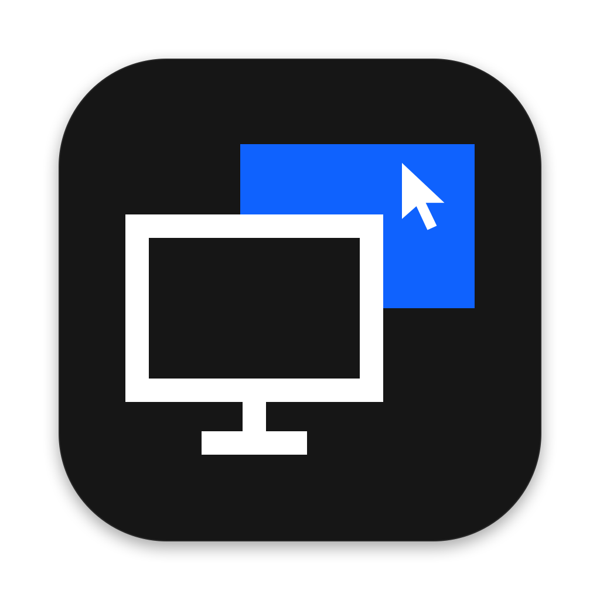
</p>

<p align="center">
  軽くて遅延の少ないリモートコントロール：高画質、Mac にも Windows にもなじむキーボード、ブラウザからも操作できます
</p>

<p align="center">
  <a href="https://nexadesk-bq9.pages.dev/ja/">公式サイト</a> · <a href="https://github.com/dollarkillerx/NexaDesk/releases/latest">ダウンロード</a>
</p>

<p align="center">
  <a href="./README.md">English</a> | <a href="./README.zh-CN.md">简体中文</a> | <strong>日本語</strong>
</p>

> **状態**：**macOS 版は正式版**で、2 台の Mac の間で日常的に使って確認しています。ブラウザ版（画面の表示・操作・コマンドライン、スマートフォン対応、自前のサーバー経由でネットワークをまたいだ接続）は Chrome でのエンドツーエンドの自動テストと、公開サーバー経由での実測を済ませています。**Windows 版はまだプレビューで、既知の問題が多く**、現時点ではおすすめしません。

## 機能

- **遅延の少ない画面** - ScreenCaptureKit でキャプチャし、VideoToolbox のハードウェアで HEVC / H.264 にエンコードします。低遅延のレート制御と長期参照フレーム（LTR）により、パケットが失われても影響を受けたフレーム以降を参照し直すだけで、キーフレームを待ちません。Wi‑Fi の短い電波の途切れと混雑を区別します。接続中は操作される側のディスプレイがスリープせず、スリープ中なら Apple の画面共有と同じように起こします。
- **通信** - 1 つの UDP ソケット上の QUIC：操作は信頼性のあるストリーム、映像はフレームごとに Reed-Solomon 誤り訂正付きの DATAGRAM で送るため、1 パケットの欠落が後続のフレームを止めません。
- **接続、既定ではサーバー不要**
  - ローカルネットワーク：mDNS で見つけて直接接続します。
  - ネットワークをまたぐ場合：**Tailscale がおすすめ**です。両方を同じ Tailscale アカウントにログインさせるだけで接続でき、NexaDesk は tailnet 内のデバイスを一覧表示し、直接接続か DERP 経由かも表示します。
  - 自前のサーバー（任意）：9 桁のデバイス ID で接続します。ホールパンチングとポートマッピング（PCP、NAT-PMP、UPnP）を試し、だめなら UDP リレー、UDP が遮断されていれば WebSocket リレーを使います。
- **Mac にも Windows にもなじむキーボード** - キーは物理キーコードで送り、ショートカットは意図に合わせて書き換えます。Mac から Windows を操作するとき ⌘C は Ctrl+C になり、Ctrl と Cmd を全体で入れ替えることはしません。対応表は編集とプレビューができます。記号は手元のキーボードに印字されたとおりに入力されるので、日本語キーボードで US 配列の Mac を操作しても打ち間違えません。
- **古い内容を貼り付けない** - クリップボードは世代ごとに同期し、貼り付けは新しい内容が相手に届くまで待ちます。大きな画像をダウンロード中でも同じです。テキストも画像も同期します。
- **ブラウザから操作** - 相手側には何もインストール不要です。
  - LAN と Tailscale では `https://操作される側のアドレス:47801` をブラウザで開きます。ページも WebRTC も操作される側が直接提供し、サーバーを通りません。
  - 自前のサーバーがあれば、どのネットワークからでもサーバーのアドレスを開いてデバイス ID を入力します。最初はサーバーの TURN で中継し、操作される側が許可してから LAN と Tailscale のアドレスをブラウザに伝え、直接つながる場合は自動で切り替えます。
  - ポインターはブラウザ側で描くので、動かしても遅れません。
  - 接続したデバイスはブラウザに保存でき、ワンタップで再接続できます。パスワードはページからも取り出せない鍵で暗号化して保存し、ワンタイムコードは保存しません。
  - スマートフォン：タッチ操作、画面キーボード、入力メソッド、Esc・Tab・修飾キー・矢印キーの列。
  - 既定ではオフです。メインウィンドウで「ブラウザからの接続を許可」をオンにします。
- **コマンドライン** - 相手のシェルだけを開けます。アプリではネイティブのターミナル（macOS と Windows で同じもの）、ブラウザでは xterm.js を使います。これは独立した権限で、既定ではオフです。セッションが終わるとシェルとそこから起動したプロセスもすべて終了します。デスクトップのない Linux / Windows マシンではコマンドライン版のホスト `nexa-term-host`（bash / PowerShell）を使います。[docs/TERM_HOST.md](docs/TERM_HOST.md) を参照してください。
- **複数人で同時に** - 最大 4 人（アプリとブラウザの合計）が同じ Mac に接続でき、一人ずつ許可し、全員が操作できます。誰かが抜けても終わるのはその人のセッションだけです。
- **ログイン方法** - ワンタイムコード（相手が許可）、固定パスワード（持ち主のための入口で確認なし）、サーバー経由ならデバイス ID だけでも可能で、相手には「本人確認できない」要求として表示されます。デバイス ID はいつでもリセットできます。
- **いつでもつながる** - NexaDesk の起動時（「再起動してアップデート」の後も含む）に「このMacの操作を許可」が自動でオンになるので、離れた場所から更新しても締め出されません。自分で停止した場合は、再び開始するまでオフのままです。ログイン時に起動することもできます。
- **その他** - カーソル形状、音声（Opus）、ファイルの送受信、複数ディスプレイ、ゲームモード（ポインターのロック、強めの誤り訂正）、30 秒以内の自動再接続、HUD と接続診断。
- **多言語** - English、简体中文、日本語。システムの言語に従い、メインウィンドウで切り替えることもできます（再起動後に反映）。
- **セキュリティ**
  - 相互 TLS。デバイスの身元はその公開鍵です。
  - 初回はワンタイムコードまたは固定パスワードで SPAKE2 によるペアリングを行い、TLS セッションに結び付けます。以降は相手の公開鍵を固定します。固定パスワードは Argon2id のハッシュだけを保存します。
  - 操作される側は接続ごとに確認し（ペアリング済みのデバイスは無人接続にも設定可能、固定パスワードは確認なし）、操作中は常にバナーを表示します。
  - ペアリングの推測は接続元ごとに制限します。

## スクリーンショット

メインウィンドウ：左側でほかのデバイスに接続し（LAN と Tailscale 上のデバイスは自動で一覧表示）、右側でこのコンピューターの操作を許可します。デバイス ID とワンタイムコードを大きく表示し（クリックでコピー）、固定パスワードと相手が入力できるアドレスも表示します。ライトとダークに自動で追従します。

<p>
  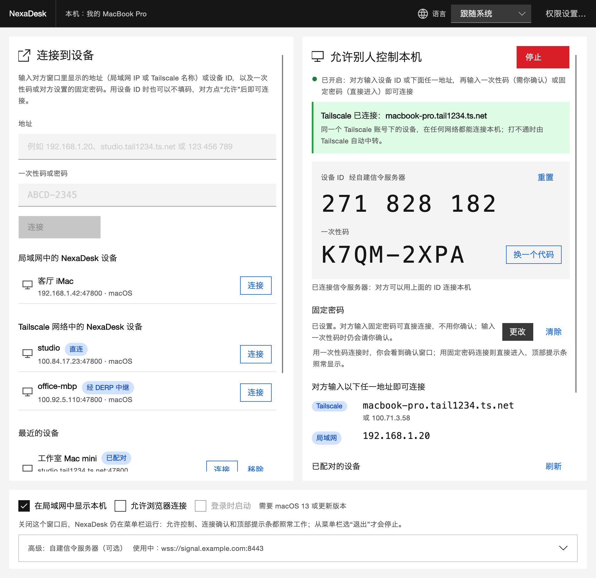
  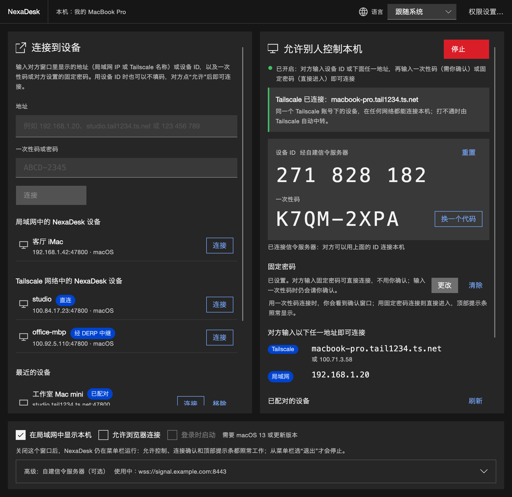
</p>

誰かが接続すると、操作される側に確認ウィンドウが出ます。相手が誰か、どう本人確認したか、鍵のフィンガープリントを示し、許可する権限を選べます。「拒否」が既定のボタンで、「許可」はウィンドウが出て 1 秒たってから押せます。ブラウザ版はインストール不要で、接続時に「画面」か「ターミナル」を選べます。接続したデバイスはブラウザに保存でき、次回はワンタップで接続できます。

<p>
  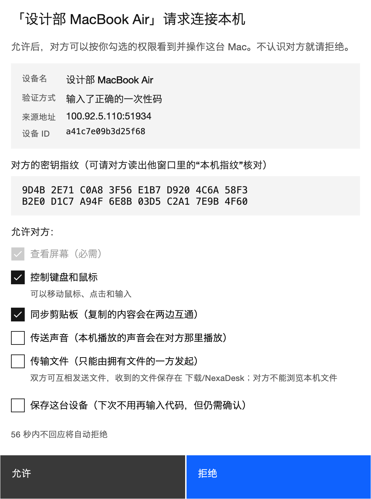
  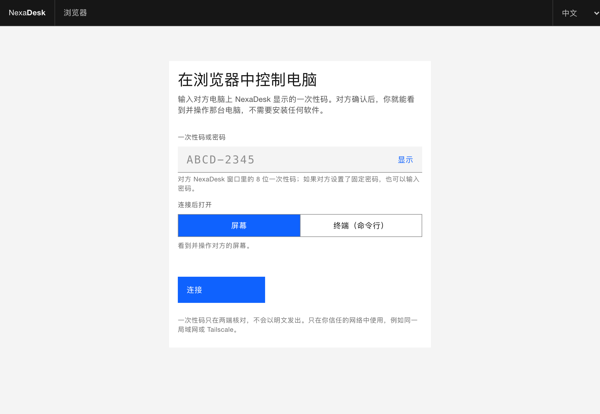
</p>

ブラウザで相手の画面を見て操作します。上部バーには接続経路、遅延、フレームレートを表示し、開くとパケットロスとビットレート、画質と解像度、記号をキーの印字どおりに入力するか位置どおりに入力するかを切り替えられます。「ターミナル」ではコマンドラインだけを開き、画面は送りません。

<p>
  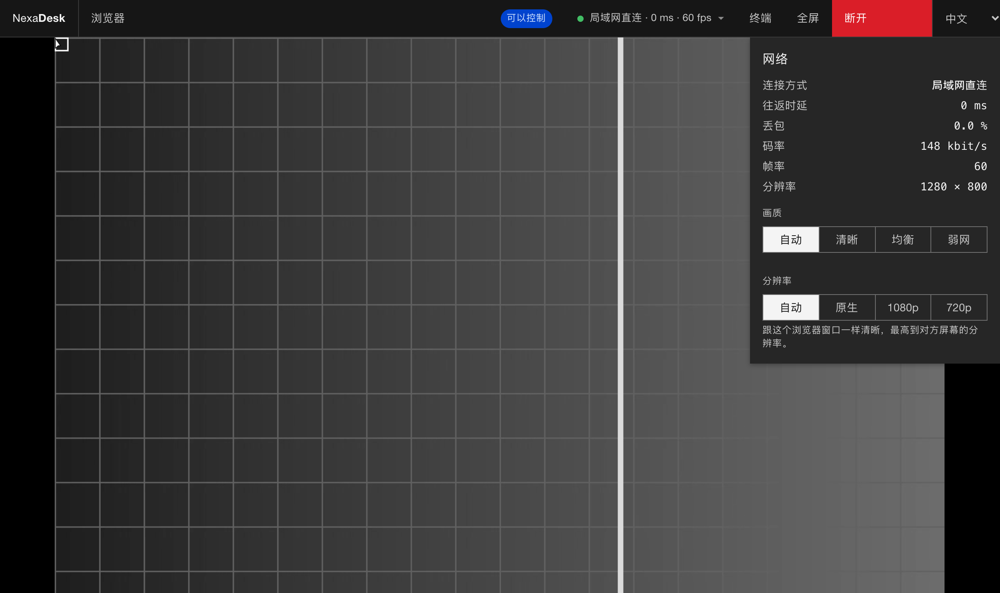
  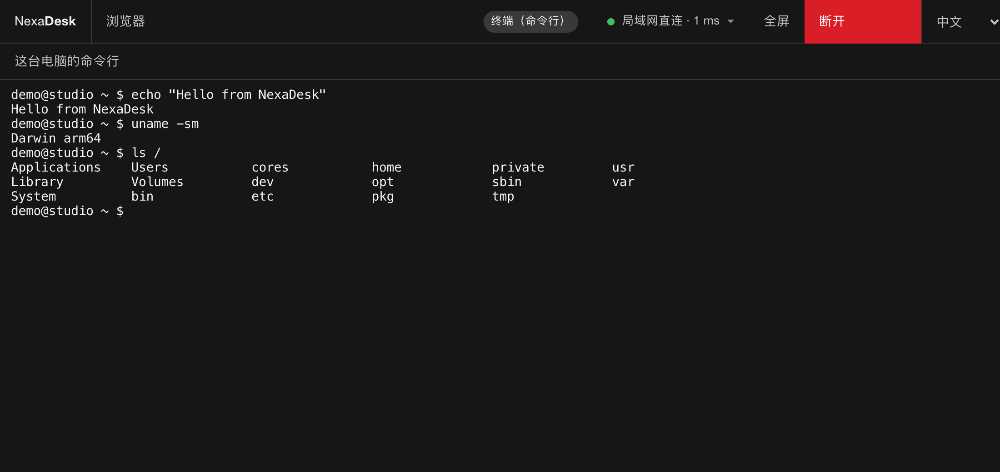
</p>

スマートフォンでは上部バーがアイコンになり、横向きでは画面に場所を譲り、キーボードを出すと Esc・Tab・修飾キー・矢印キーの列が加わります。

<p>
  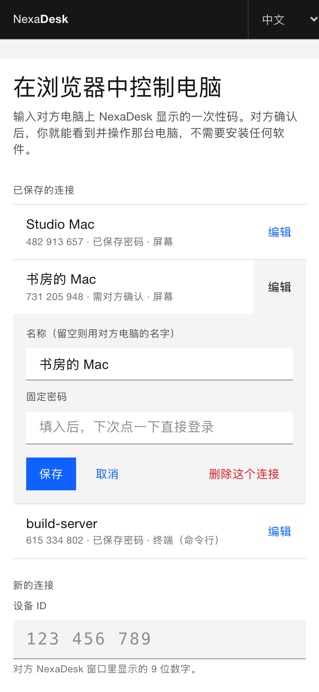
  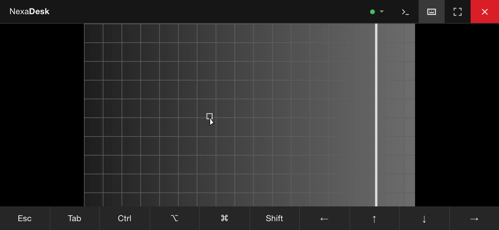
</p>

操作するときは画面の上にツールバー（モード、音声、ファイル、HUD、診断）があり、脇に寄せられる小さなタブにたためます。操作されているときは画面上部にバナーが常に表示され、接続している人ごとに 1 行で、それぞれ切断できます。移動できる小さなタブにたためますが、完全には隠れません。

<p>
  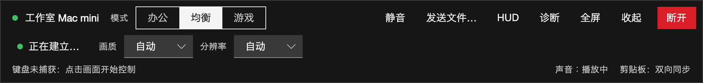<br>
  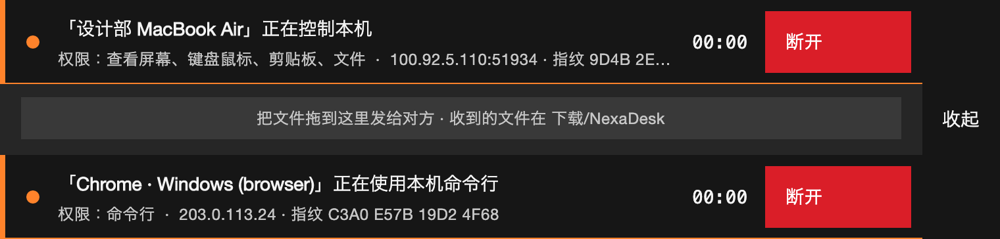
  
</p>

<sub>スクリーンショットのデバイス、アドレス、コード、保存した接続はすべて架空のものです。UI を変更したら `scripts/screenshots.sh` で作り直します。アプリの画面は `ui/NexaDesk.Screenshots` が実際の UI コードで画面外に描画し、ブラウザのページは `scripts/web-screenshots.mjs` がヘッドレスの Google Chrome でデモホストに接続して撮影します（PC とスマートフォンのサイズ）。</sub>

## ダウンロード

[GitHub Releases](https://github.com/dollarkillerx/NexaDesk/releases/latest) または[公式サイト](https://nexadesk-bq9.pages.dev/ja/)から：

- **macOS**（Apple シリコン、macOS 14 以降）：[NexaDesk-macOS.dmg](https://github.com/dollarkillerx/NexaDesk/releases/latest/download/NexaDesk-macOS.dmg)。Developer ID で署名し、Apple の公証済みです。
- **Windows**（x64、Windows 10 / 11、プレビュー版。既知の問題が多く、現時点では非推奨）：[NexaDesk-win-Setup.exe](https://github.com/dollarkillerx/NexaDesk/releases/latest/download/NexaDesk-win-Setup.exe)。ユーザーごとにインストールし、管理者権限は不要です。まだコード署名していないため、SmartScreen が出たら **詳細情報 → 実行** を選んでください。

どちらも自動で更新します（[Velopack](https://velopack.io)）。起動時とその後 1 日 1 回 GitHub Releases を確認し、新しいバージョンをバックグラウンドでダウンロードして、メインウィンドウ下部に「再起動してアップデート」を表示します。再起動するとリモート接続が切れるため、自動では再起動しません。

## 使い方

1. 両方の Mac で NexaDesk を開き、求められたら「画面収録」と「アクセシビリティ」を許可します（LAN で初めて使うときは「ローカルネットワーク」も）。
2. 同じネットワークにない場合は、両方に [Tailscale](https://tailscale.com/download) をインストールし、同じアカウントでログインします。
3. 操作される側で「このMacの操作を許可」の「開始」をクリックします。既定ではすべてのネットワークで待ち受け、相手が入力できるアドレス（Tailscale 名、LAN の IP）とワンタイムコードを表示します。
4. 操作する側で相手を選び、ワンタイムコードを入力します：
   - 「ローカルネットワーク上のNexaDeskデバイス」または「Tailscaleネットワーク上のNexaDeskデバイス」で「接続」をクリックする
   - または相手のアドレスを入力する（例：`192.168.1.20`、`studio.tail1234.ts.net`。既定のポートは 47800）
5. 相手が許可すると操作が始まります。ペアリング済みのデバイスは次回から直接接続できます。

Tailscale を使えない場合は、自前のシグナリングサーバーを立てて 9 桁のデバイス ID で接続できます。[docs/DEPLOY.md](docs/DEPLOY.md) を参照し、メインウィンドウの「詳細：自前のシグナリングサーバー（任意）」にアドレスを入力してください。

操作される側で**固定パスワード**を設定すると、確認なしで直接入れます。自分のコンピューターに向いています。

デスクトップのない Linux や Windows マシンには、コマンドライン版のホストを使います。`scripts/build-term-host.sh` でビルドし、`nexa-term-host --signal wss://自分のサーバー:8443` で起動して、ブラウザでサーバーのアドレスを開き、「ターミナル」を選んで表示されたデバイス ID を入力します。詳しくは [docs/TERM_HOST.md](docs/TERM_HOST.md) を参照してください。

操作される側はコマンドラインからも起動でき、ターミナルで接続を確認できます：

```bash
nexa-agent --listen '[::]:47800'
```

`nexa-agent --help` ですべてのオプションを表示します（例：`--paired-only`、`--relay-only`、`--no-lan-discovery`）。

接続が切れた理由を知りたいとき：NexaDesk.app は操作される側のログを `~/Library/Logs/NexaDesk/agent.log` に書きます。各セッションの開始・終了と理由に加え、5 秒ごとに映像の統計（フレーム数、ビットレート、目標値、Wi‑Fi の途切れ）を 1 行記録します。1 MB を超えると古いログは `agent.log.1` に移ります。

## ソースからビルド

必要なもの：macOS 14 以降、Xcode コマンドラインツール、Rust stable（edition 2024）、[.NET 10 SDK](https://dotnet.microsoft.com/download/dotnet/10.0)。

```bash
git clone https://github.com/dollarkillerx/NexaDesk.git
cd NexaDesk

scripts/package-macos.sh                              # アプリ：dist/NexaDesk.app
cargo build --release -p nexa-agent -p nexa-client    # Rust 部分だけ
```

既定ではアドホック署名なので、ビルドし直すたびに macOS は別のアプリとみなし、「画面収録」「アクセシビリティ」とキーチェーンの「常に許可」を求め直します。次のスクリプトを一度実行してログインキーチェーンにローカル署名用の証明書（「NexaDesk Local Signing」）を作ると、以降のビルドはそれで署名され、許可が保たれます：

```bash
scripts/make-signing-identity.sh
```

この証明書の秘密鍵はこの Mac の外に出さないでください。持っている人は、macOS が NexaDesk とみなし同じ権限を持つプログラムに署名できます。キーチェーンに Developer ID Application 証明書があれば、スクリプトはそちらを使い、Hardened Runtime を有効にします（公証に必要）。

アプリのアイコンは `assets/icon/` にあり、`scripts/make-app-icon.swift` でコードから描いています。変更したら `scripts/make-app-icon.sh` で作り直します。

### リリース

Mac で両方のプラットフォームのパッケージを作り、`dist/macos/` と `dist/windows/` のファイルをすべて同じ GitHub Release にアップロードします（アップデーターは最新の Release から `releases.osx.json` / `releases.win.json` を読みます）：

```bash
NEXA_NOTARY_PROFILE=<notarytool のプロファイル名> scripts/package-macos.sh
scripts/package-windows.sh
```

バージョンは `ui/NexaDesk.App/NexaDesk.App.csproj` の `<Version>` から取ります。Windows 版は mingw でクロスコンパイルします。[docs/WINDOWS.md](docs/WINDOWS.md) を参照してください。

### テスト

```bash
cargo test --workspace
dotnet test ui/NexaDesk.Tests
```

実機や実際のネットワークが必要なテスト（実際のマルチキャスト、画面キャプチャ、システムの許可ダイアログを出すものなど）は既定で無視されます。

画面収録の許可なしでブラウザ版を試すには（合成した画面を実際の H.264 エンコーダーで送り、受け取ったマウスとキーを画面に描きます）：

```bash
cargo run -p nexa-web --example demo
```

ブラウザで `https://この Mac の LAN アドレス:47801`（127.0.0.1 ではなく）を開き、自己署名証明書を受け入れて、ターミナルに表示されたワンタイムコードを入力します。F9 を押すとデモホストがテキストを 1 行「コピー」するので、クリップボードを試せます。`crates/nexa-web-pake` を変更したら、`scripts/build-web-pake.sh` で `crates/nexa-web-page/web/pake.wasm` を作り直します。

## リポジトリの構成

| パス | 内容 |
|---|---|
| `crates/nexa-wire` | 通信フォーマット：データグラム、フレーム、制御メッセージ、シグナリングメッセージ |
| `crates/nexa-net` | QUIC ソケット、輻輳とレートの制御、FEC、STUN、ホールパンチング、経路管理、ポートマッピング、Tailscale、mDNS |
| `crates/nexa-media` | キャプチャ、エンコード / デコード、表示、カーソル、音声（macOS と Windows） |
| `crates/nexa-input` | ショートカットの書き換え、キー配列表、入力のキャプチャと注入 |
| `crates/nexa-clip` | クリップボードの同期と貼り付けゲート |
| `crates/nexa-auth` | デバイスの身元、ペアリング、鍵の固定、アクセスの判断 |
| `crates/nexa-session` | セッションのハンドシェイク、操作される側と操作する側のセッション処理、ファイル転送、再接続、ランデブー |
| `crates/nexa-agent` | 操作される側のプロセス `nexa-agent` |
| `crates/nexa-client` | 操作する側のライブラリ `libnexa_client`（UI から呼ぶ C ABI） |
| `crates/nexa-signal` | シグナリング + STUN + リレーサーバー `nexa-signal` |
| `crates/nexa-web` | ブラウザからのアクセス：HTTPS、シグナリング、WebRTC（str0m）。操作される側が提供し、サーバー経由のセッションは TURN を使う |
| `crates/nexa-web-page` | ブラウザ版のページ。操作される側とシグナリングサーバーで共用 |
| `crates/nexa-turn` | TURN サーバーとクライアント（純粋な状態機械）。同じサーバー上の割り当て間だけを中継 |
| `crates/nexa-web-pake` | ブラウザ側のペアリング（SPAKE2）。WebAssembly にコンパイル |
| `crates/nexa-term` | 疑似端末上のシェル（Linux / macOS は PTY、Windows は ConPTY）。セッション終了時にプロセスツリーごと終了 |
| `crates/nexa-term-host` | コマンドラインだけの操作される側 `nexa-term-host`（Linux、Windows サーバー向け） |
| `ui/` | Avalonia のデスクトップアプリ（.NET 10）、ターミナルコントロール（`NexaDesk.Terminal`）、テスト、README のスクリーンショットツール |
| `deploy/` | サーバー用の systemd ユニット、Docker イメージと Compose、設定テンプレート、証明書更新フック |
| `docs/` | 設計文書、デプロイ手順、M0 検証レポート |
| `spikes/` | M0 の検証コード |
| `third_party/` | 小さなパッチを当てたサードパーティのコード（dimpl。Linux 版が aws-lc に依存しないため）。説明は中の README |

## ドキュメント

- [docs/DESIGN.md](docs/DESIGN.md)：全体の設計とマイルストーン
- [docs/DETAILED_DESIGN.md](docs/DETAILED_DESIGN.md)：詳細設計。各章の末尾に実装と設計の違いを記録
- [docs/DEPLOY.md](docs/DEPLOY.md)：シグナリング、STUN、リレーサーバーのデプロイ
- [docs/WEB_CLIENT.md](docs/WEB_CLIENT.md)：ブラウザ版
- [docs/TERM_HOST.md](docs/TERM_HOST.md)：Linux / Windows のコマンドライン版ホスト
- [docs/WINDOWS.md](docs/WINDOWS.md)：Windows 版
- [docs/spikes/M0-report.md](docs/spikes/M0-report.md)：M0 検証レポート

設計文書は中国語です。

## まだできていないこと

- **検証**：実際の NAT 環境でのホールパンチング（自前のサーバー経由の中継はインターネット上で実測済み。docs/DEPLOY.md §6 を参照）。
- **macOS**：ログイン画面とロック画面でのリモートアクセス。
- **Windows**：実機で見つかった多くの問題（操作される側・操作する側とも）、操作する側での相手のポインター形状の表示、HEVC、音声、サービスとしての実行（ログイン画面と UAC）。[docs/WINDOWS.md](docs/WINDOWS.md) を参照してください。
- **ブラウザ**：iPhone / Safari、Firefox での実測（Android の Chrome は使用中）、UDP が遮断されたネットワーク向けの TURN over TCP/TLS、音声とファイル転送。
- **コマンドライン版ホスト**：Windows 版の実機での動作、Windows サービスとしての実行。
- **製品としての判断**：無人のマシンを最初にどうペアリングするか、ID だけを知っている人に既定で何を許すか、ファイルの権限を方向ごとに分けるか。
