# NexaDesk

<p align="center">
  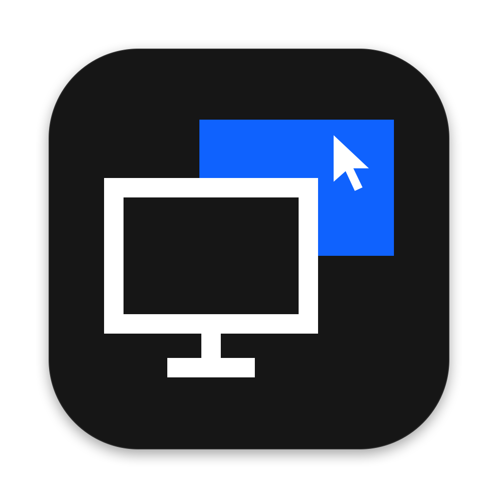
</p>

<p align="center">
  가볍고 지연 시간이 짧은 원격 제어: 선명한 화면, Mac과 Windows 모두에 맞는 키보드, 어떤 브라우저에서나 가능한 제어, 그리고 허용한 컴퓨터를 조작하는 AI 에이전트
</p>

<p align="center">
  <a href="https://nexadesk-bq9.pages.dev/ko/">웹사이트</a> · <a href="https://github.com/dollarkillerx/NexaDesk/releases/latest">다운로드</a>
</p>

<p align="center">
  <a href="./README.md">English</a> | <a href="./README.zh-CN.md">简体中文</a> | <a href="./README.zh-TW.md">繁體中文</a> | <a href="./README.ja-JP.md">日本語</a> | <strong>한국어</strong>
</p>

## 기능

- **지연 시간이 짧은 화면** - ScreenCaptureKit 캡처, 지연 시간이 짧은 전송률 제어와 장기 참조 프레임을 갖춘 VideoToolbox 하드웨어 HEVC / H.264: 손실이 생기면 그 프레임에 의존하는 프레임만 다시 참조하며, 키프레임을 기다리지 않습니다. Wi-Fi 무선 신호가 잠시 멈추는 것과 네트워크 혼잡을 구별합니다. 보고 있는 디스플레이는 잠자기에 들어가지 않으며, 잠자기 중인 디스플레이는 Apple 화면 공유처럼 깨웁니다.
- **전송** - 하나의 UDP 소켓 위의 QUIC: 제어는 신뢰성 있는 스트림으로, 영상은 프레임마다 Reed-Solomon 오류 정정을 붙인 DATAGRAM으로 보내므로, 패킷 하나를 잃어도 뒤따르는 프레임이 멈추지 않습니다.
- **연결, 기본적으로 서버 불필요**
  - 로컬 네트워크: mDNS로 찾아 직접 연결합니다.
  - 다른 네트워크 사이: **Tailscale 권장**. 두 컴퓨터를 같은 Tailscale 계정에 로그인하세요. NexaDesk는 tailnet의 기기를 나열하고 경로가 직접 연결인지 DERP를 통한 릴레이인지 표시합니다.
  - 직접 운영하는 서버(선택 사항): 9자리 기기 ID로 연결하며, 홀 펀칭과 포트 매핑(PCP, NAT-PMP, UPnP)을 시도하고, 다음으로 UDP 릴레이를, UDP가 차단된 곳에서는 WebSocket 릴레이를 사용합니다.
- **Mac과 Windows 모두를 위한 키보드** - 키는 물리적 코드대로, 단축키는 의도대로 전송됩니다. Mac에서 Windows를 제어할 때 ⌘C는 Ctrl+C로 전송되며, Ctrl과 Cmd를 모든 곳에서 맞바꾸지 않습니다. 매핑은 편집하고 미리 볼 수 있습니다. 기호는 내 키보드에 표시된 대로 입력되므로, 일본어 키보드로 US 배열 Mac을 제어해도 올바른 문자가 입력됩니다.
- **오래된 내용이 붙여넣어지지 않음** - 클립보드는 세대 단위로 동기화되며, 붙여넣기는 새 내용이 상대방에게 도착할 때까지 기다립니다. 아직 다운로드 중인 큰 이미지도 마찬가지입니다. 텍스트와 이미지 모두 동기화됩니다.
- **브라우저에서 제어** - 상대방에게는 설치할 것이 없습니다.
  - LAN과 Tailscale에서는 `https://host-address:47801`을 엽니다. 페이지와 WebRTC는 어떤 서버도 거치지 않고 호스트 자체에서 제공됩니다.
  - 직접 운영하는 서버가 있으면 어떤 네트워크에서든 서버 주소를 열고 기기 ID를 입력합니다. 트래픽은 처음에 서버의 TURN 릴레이를 거치며, 호스트가 연결을 허용하면 호스트가 LAN과 Tailscale 주소를 알려 주고, 가능하면 브라우저가 직접 경로로 전환합니다.
  - 포인터는 내 쪽에서 그려지므로 지연 없이 움직입니다.
  - 저장한 기기는 한 번의 탭으로 다시 연결됩니다. 저장한 비밀번호는 페이지가 내보낼 수 없는 키로 암호화되며, 일회용 코드는 저장하지 않습니다.
  - 휴대폰: 터치 제스처, 화면 키보드, 입력기, 그리고 Esc, Tab, 보조 키, 화살표 키로 된 키 줄.
  - 기본값은 꺼짐: 설정에서 ‘브라우저 연결 허용’을 켜세요.
- **명령줄** - 호스트의 셸만 열 수 있습니다. 앱에서는 네이티브 터미널 컨트롤(macOS와 Windows에서 동일)로, 브라우저에서는 xterm.js로 엽니다. 별도의 권한이며 기본값은 꺼짐이고, 세션이 끝나면 셸과 셸이 시작한 모든 것이 함께 종료됩니다. 데스크톱이 없는 Linux 및 Windows 컴퓨터는 명령줄 호스트 `nexa-term-host`(bash / PowerShell)를 실행합니다. [docs/TERM_HOST.md](docs/TERM_HOST.md)를 참조하세요.
- **AI 에이전트(MCP)** - NexaDesk에는 MCP 서버가 포함되어 있어 Claude Code, Codex, Claude Desktop 같은 AI 앱이 허용한 컴퓨터를 조작할 수 있습니다. AI 앱은 화면을 요소 트리로 읽고 그 요소에 작업하며, 필요할 때 스크린샷을 찍고, 명령줄에서 명령을 실행하고, 파일을 보내고 가져옵니다. 로그인은 저장한 비밀번호로 NexaDesk가 대신 하므로 AI는 비밀번호, 코드, 키를 절대 보지 못하며, 조작되는 컴퓨터는 매번 허용 여부를 묻고 AI라는 것을 표시합니다. 아래 [AI 에이전트](#ai-에이전트mcp)를 참조하세요.
- **여러 사람이 동시에** - 최대 4명(앱과 브라우저 합산)이 같은 Mac에 연결할 수 있으며, 각자 따로 허용되고 각자 제어할 수 있습니다. 나가는 사람은 자신의 세션만 종료합니다.
- **로그인** - 일회용 코드(호스트가 허용), 고정 비밀번호(소유자 본인을 위한 입구, 확인 창 없음), 또는 서버를 통해 기기 ID만으로 연결할 수 있으며, 이 경우 호스트에는 확인되지 않은 요청으로 표시됩니다. 기기 ID는 언제든지 재설정할 수 있습니다.
- **항상 연결 가능** - NexaDesk가 시작되면 원격 제어가 켜지며, ‘재시작하여 업데이트’ 후에도 마찬가지이므로 멀리서 호스트를 업데이트해도 접속할 수 없게 되는 일이 없습니다. 직접 중지하면 다시 시작할 때까지 꺼진 상태로 유지됩니다. 로그인 시 시작하도록 설정할 수도 있습니다.
- **그 밖의 기능** - 포인터 모양, 소리(Opus), 파일 전송, 여러 디스플레이, 게임 모드(포인터 잠금, 더 강한 오류 정정), 30초 이내 자동 다시 연결, HUD와 연결 진단.
- **다국어** - 영어, 중국어 간체, 중국어 번체, 일본어, 한국어. 시스템 언어를 따르며, 설정에서 바꿀 수 있습니다(재시작 후 적용).
- **보안**
  - 상호 TLS. 기기의 신원은 그 기기의 공개 키입니다.
  - 처음 연결할 때는 일회용 코드나 고정 비밀번호를 사용하여 TLS 세션에 묶인 SPAKE2로 페어링하며, 그 후로는 상대방의 키를 고정합니다. 고정 비밀번호는 Argon2id 해시로만 보관됩니다.
  - 호스트는 연결마다 확인하며(페어링된 기기는 무인 연결로 설정할 수 있고, 고정 비밀번호는 바로 들어옵니다), 연결되어 있는 동안 계속 배너를 표시합니다.
  - 페어링 추측 시도는 접속 출처마다 제한됩니다.

## 스크린샷

메인 창에는 하려는 일마다 페이지가 있습니다. ‘연결’은 LAN과 Tailscale 기기를 자동으로 나열하고, 이전에 사용한 기기를 배지(페어링됨, 비밀번호 저장됨, AI 허용됨)와 함께 보여 줍니다. ‘원격 제어 허용’은 이 컴퓨터의 기기 ID와 일회용 코드를 크게 표시하고(클릭하면 복사), 다른 사람이 입력할 수 있는 주소를 보여 줍니다. 나머지는 ‘페어링된 기기’와 ‘설정’에 있습니다. 라이트 모드와 다크 모드를 따릅니다.

<p>
  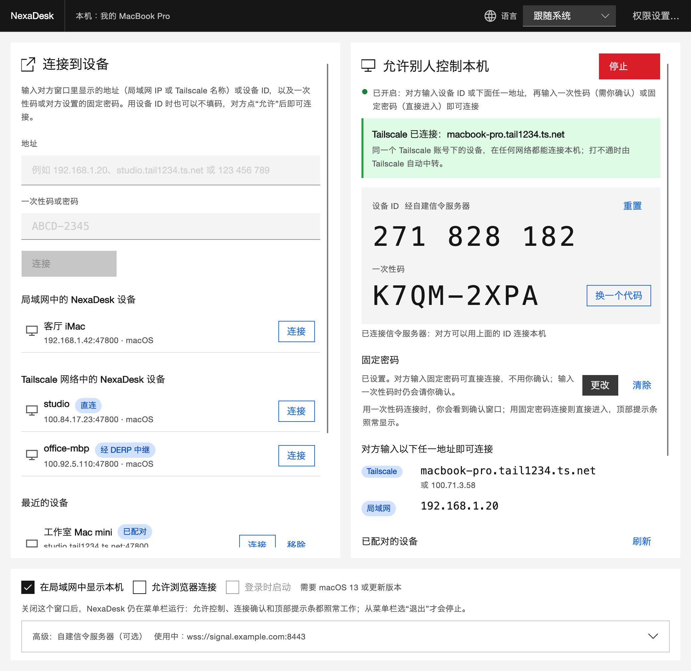
  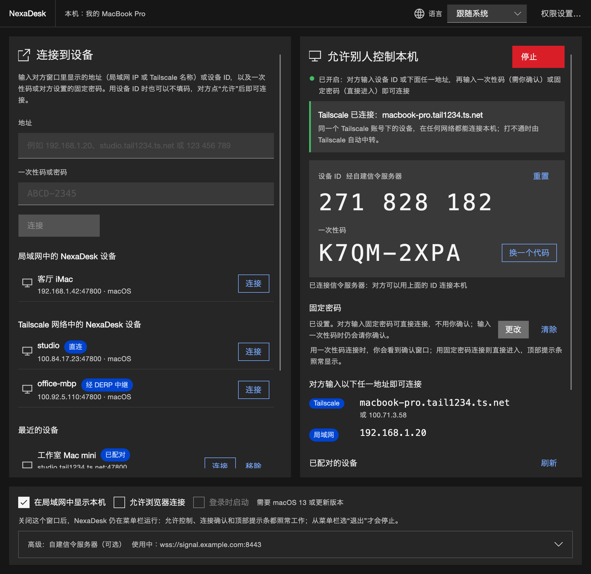
</p>
<p>
  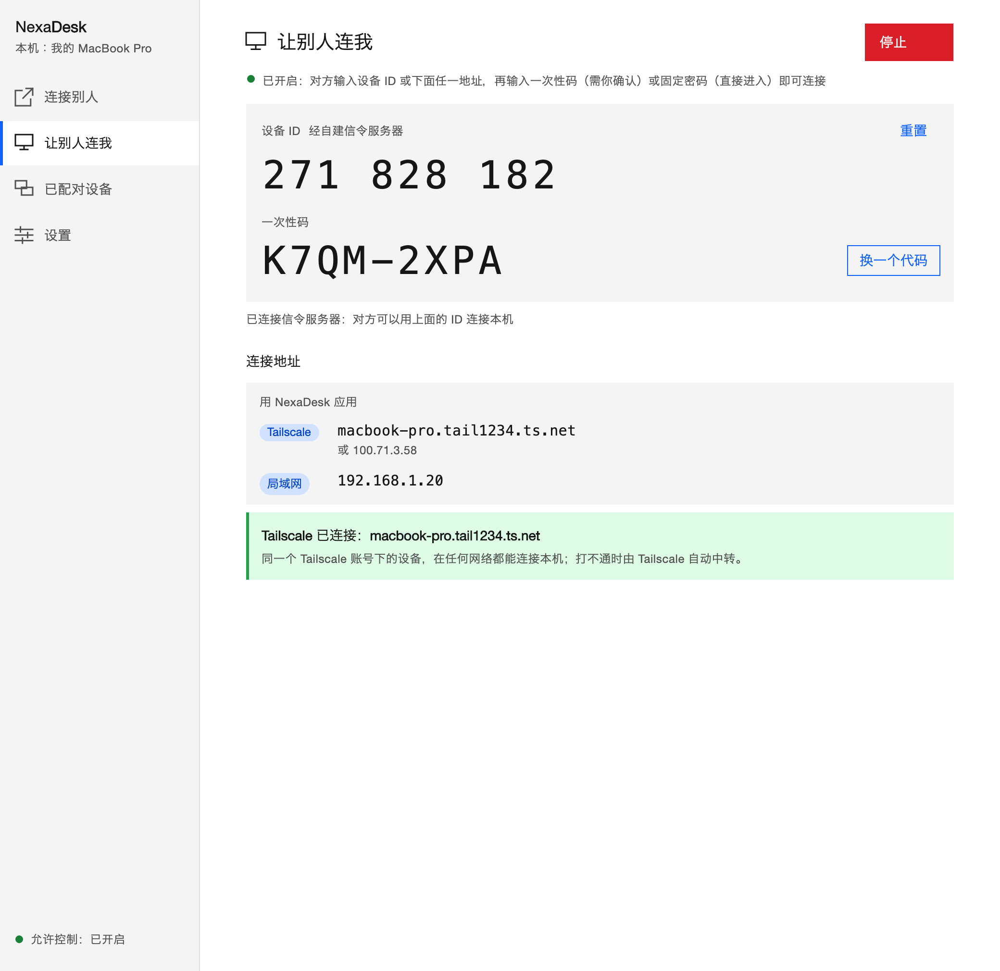
</p>

누군가 연결하면 호스트가 묻습니다. 누구인지, 어떻게 증명했는지, 키 지문, 그리고 어떤 권한을 허용할지 보여 줍니다. ‘거부’가 기본 버튼이며, ‘허용’은 확인 창이 나타나고 1초가 지나야 작동합니다. 브라우저 뷰어는 설치가 필요 없습니다. 연결할 때 ‘화면’ 또는 ‘터미널’을 선택하고, 기기를 브라우저에 저장해 두면 한 번의 탭으로 다시 연결할 수 있습니다.

<p>
  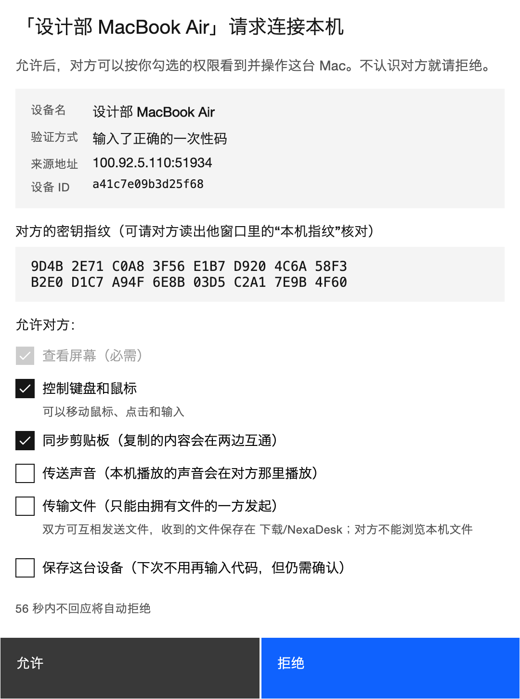
  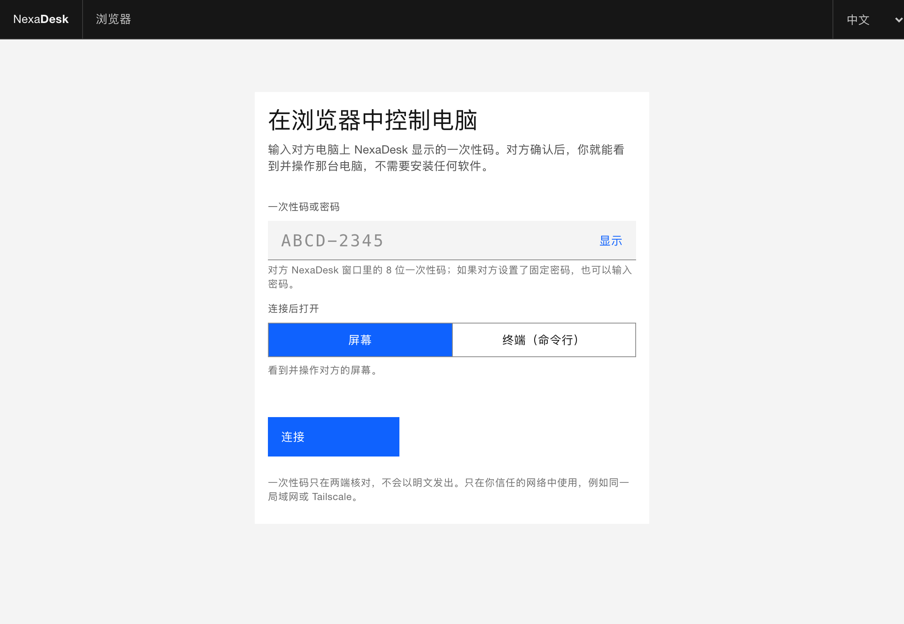
</p>

브라우저에 표시된 호스트의 화면입니다. 상단 막대에는 경로, 지연 시간, 프레임률이 표시됩니다. 막대를 열면 손실과 비트레이트, 화질과 해상도, 그리고 기호를 키에 표시된 문자대로 입력할지 키 위치대로 입력할지를 볼 수 있습니다. ‘터미널’은 화면 없이 명령줄만 엽니다.

<p>
  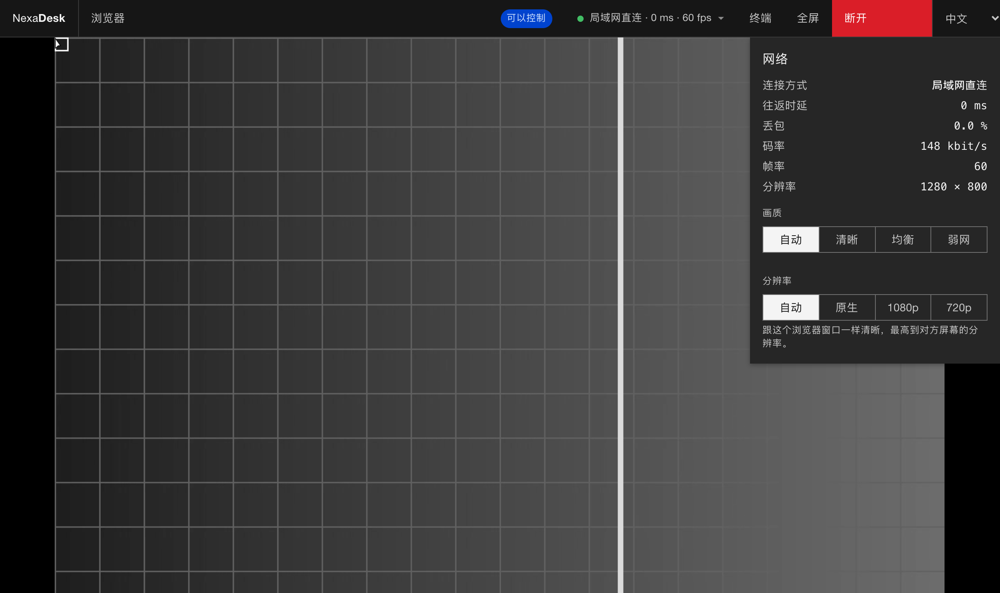
  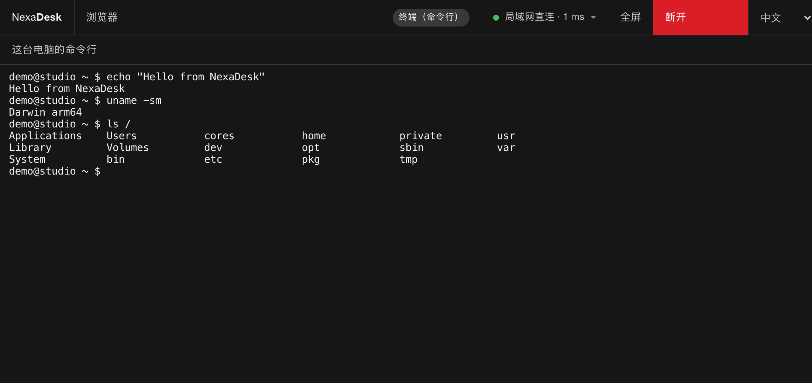
</p>

휴대폰에서는 상단 막대가 아이콘으로 바뀌고, 가로 방향에서는 화면에 더 많은 공간을 주며, 키보드를 열면 Esc, Tab, 보조 키, 화살표 키로 된 키 줄이 함께 나타납니다.

<p>
  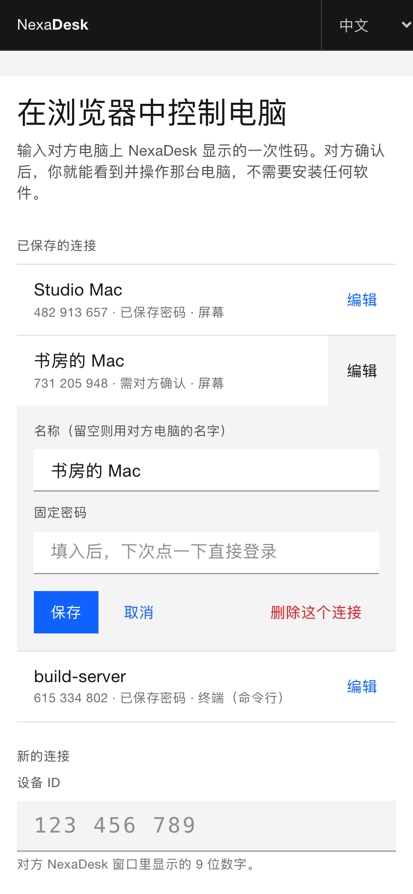
  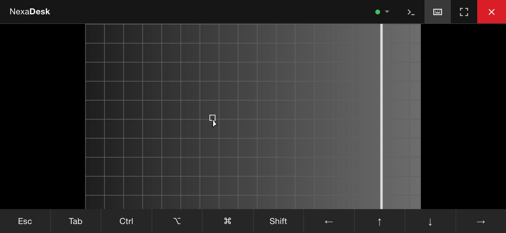
</p>

제어하는 동안 도구 막대는 화면 위에 있으며(모드, 소리, 파일, HUD, 진단), 옆으로 드래그해 둘 수 있는 작은 탭으로 접힙니다. 제어되는 동안 호스트는 상단에 배너를 표시하며, 사람이나 AI 에이전트마다 한 줄씩 각자의 ‘연결 끊기’가 있습니다. 배너는 옮길 수 있는 작은 탭으로 접히지만 절대 숨겨지지 않습니다.

<p>
  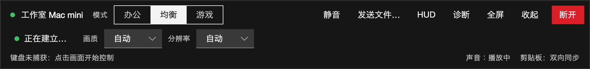<br>
  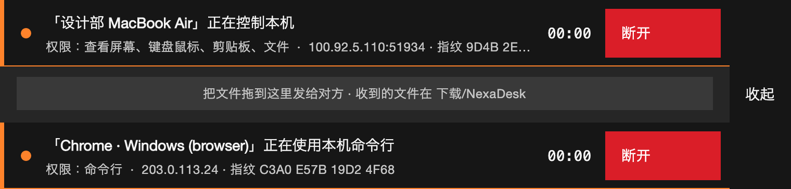
  
</p>

AI 에이전트: 설정 → ‘AI 에이전트(MCP)’에서 이 컴퓨터의 AI 앱을 위한 MCP 서버를 켜고, AI 앱에 추가하는 명령 한 줄이나 JSON을 확인하며, 어떤 AI 앱이 어떤 기기를 조작하고 있는지 보고 ‘모두 중지’할 수 있습니다. 조작되는 컴퓨터는 먼저 허용 여부를 묻고, AI라는 것을 알립니다.

<p>
  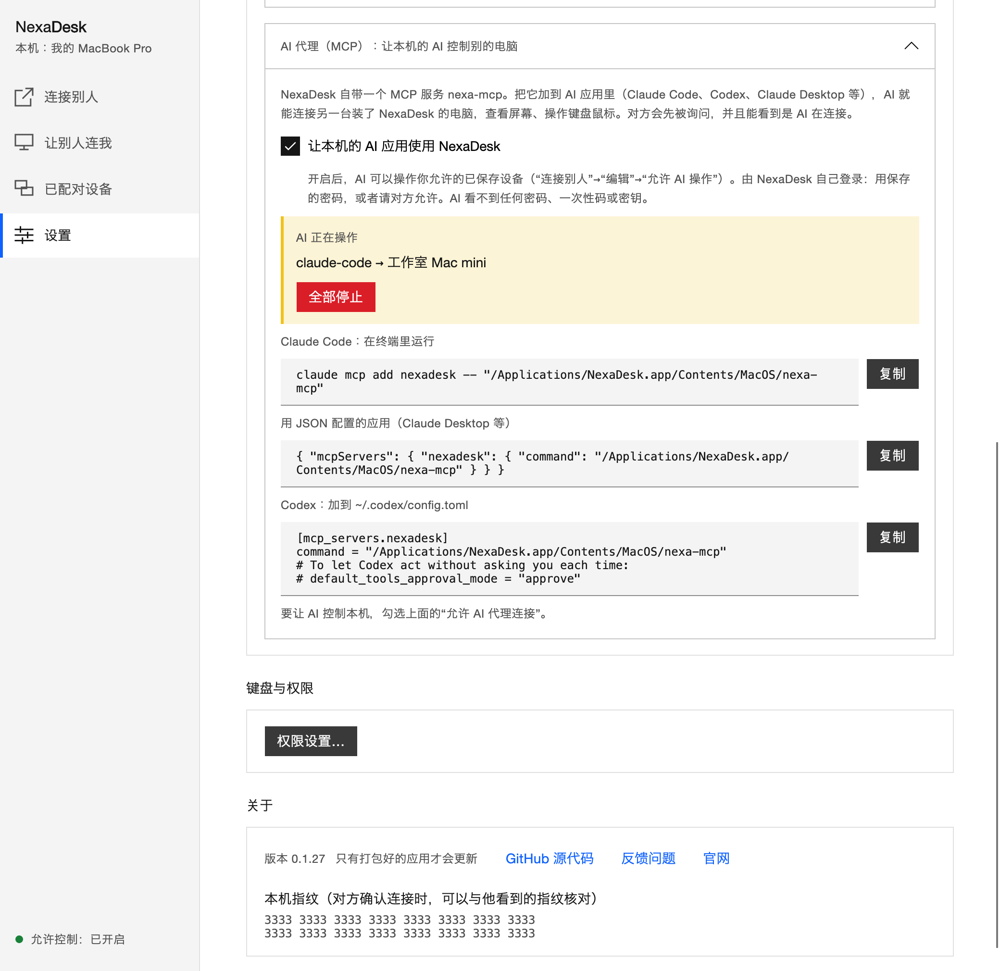
  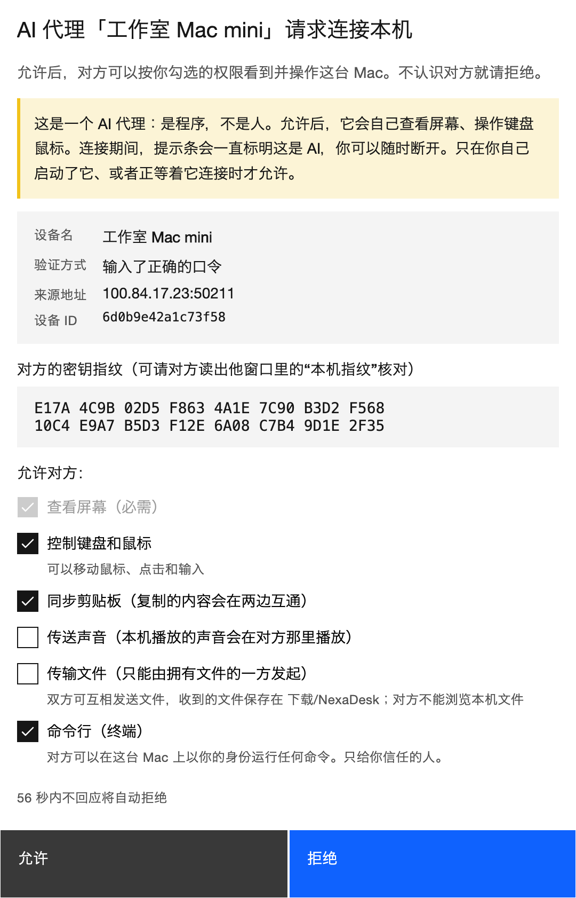
</p>

<sub>스크린샷의 기기, 주소, 코드, 저장된 연결은 모두 가상의 것입니다. UI를 변경한 후에는 `scripts/screenshots.sh`로 다시 생성하세요. 앱 창은 `ui/NexaDesk.Screenshots`가 실제 UI 코드로 화면 밖에서 렌더링하고, 브라우저 페이지는 `scripts/web-screenshots.mjs`가 헤드리스 Google Chrome에서 데모 호스트를 대상으로 캡처합니다(데스크톱과 휴대폰 크기).</sub>

## 다운로드

[GitHub Releases](https://github.com/dollarkillerx/NexaDesk/releases/latest) 또는 [웹사이트](https://nexadesk-bq9.pages.dev/ko/)에서 받을 수 있습니다:

- **macOS**(Apple 실리콘, macOS 14 이상): [NexaDesk-macOS.dmg](https://github.com/dollarkillerx/NexaDesk/releases/latest/download/NexaDesk-macOS.dmg). Developer ID로 서명되었으며 Apple의 공증을 받았습니다.
- **Windows**(x64, Windows 10 / 11): [NexaDesk-win-Setup.exe](https://github.com/dollarkillerx/NexaDesk/releases/latest/download/NexaDesk-win-Setup.exe). 사용자별로 설치되며 관리자 권한이 필요하지 않습니다. 아직 코드 서명이 되어 있지 않으므로 SmartScreen이 나타나면 **추가 정보 → 실행**을 선택하세요.

두 앱 모두 자동으로 업데이트됩니다([Velopack](https://velopack.io)). 시작할 때와 그 후 매일 GitHub Releases를 확인하고, 새 버전을 백그라운드에서 다운로드하여 설정에 ‘재시작하여 업데이트’를 표시합니다. 재시작하면 원격 세션이 끊기므로 스스로 재시작하지는 않습니다.

## 시작하기

1. 두 Mac에서 NexaDesk를 열고, 요청이 나오면 ‘화면 기록’과 ‘손쉬운 사용’ 권한을 허용하세요(LAN에서 처음 사용할 때는 ‘로컬 네트워크’도).
2. 같은 네트워크에 있지 않나요? 두 컴퓨터에 [Tailscale](https://tailscale.com/download)을 설치하고 같은 계정으로 로그인하세요.
3. 호스트의 ‘원격 제어 허용’ 페이지에서 ‘시작’을 클릭하세요. 기본적으로 모든 네트워크에서 연결을 기다리며, 다른 사람이 입력할 수 있는 주소(Tailscale 이름, LAN IP)와 일회용 코드를 표시합니다.
4. 뷰어의 ‘연결’ 페이지에서 호스트를 선택하고 일회용 코드를 입력하세요:
   - ‘로컬 네트워크의 NexaDesk 기기’ 또는 ‘내 Tailscale 네트워크의 NexaDesk 기기’에서 ‘연결’을 클릭하거나,
   - 주소를 입력합니다. 예: `192.168.1.20` 또는 `studio.tail1234.ts.net`(기본 포트 47800).
5. 호스트가 허용하면 제어가 시작됩니다. 페어링된 기기는 다음부터 바로 연결됩니다.

Tailscale 없이 사용하려면 시그널링 서버를 직접 운영하고 9자리 기기 ID로 연결하세요. 아래 [시그널링 서버 직접 운영하기](#시그널링-서버-직접-운영하기)를 참조하세요.

내 컴퓨터라면 호스트에 **고정 비밀번호**를 설정하여 확인 창 없이 바로 들어갈 수 있습니다.

데스크톱이 없는 Linux 또는 Windows 컴퓨터: `scripts/build-term-host.sh`로 명령줄 호스트를 빌드하고 `nexa-term-host --signal wss://your-server:8443`을 실행한 다음, 브라우저에서 서버 주소를 열고 ‘터미널’을 선택하여 호스트가 출력한 기기 ID를 입력하세요. [docs/TERM_HOST.md](docs/TERM_HOST.md)를 참조하세요.

호스트는 명령줄에서 실행하고 터미널에서 연결을 확인할 수도 있습니다:

```bash
nexa-agent --listen '[::]:47800'
```

`nexa-agent --help`는 모든 옵션을 나열합니다. 예: `--paired-only`, `--relay-only`, `--no-lan-discovery`.

## AI 에이전트(MCP)

내 컴퓨터의 AI 앱은 NexaDesk를 통해 사람이 하듯이 다른 컴퓨터를 조작합니다. NexaDesk가 로그인하고, 조작되는 컴퓨터는 그 앞에 있는 사람에게 묻고, AI는 화면을 보고 작업합니다.

1. AI가 실행되는 컴퓨터에서 설정 → ‘AI 에이전트(MCP)’를 열고 ‘이 컴퓨터의 AI 앱이 NexaDesk를 사용하도록 허용’을 켜세요. 사용하는 AI 앱에 맞는 명령을 그곳에서 복사하세요. 예를 들어 Claude Code의 경우:
   ```bash
   claude mcp add nexadesk -- "/Applications/NexaDesk.app/Contents/MacOS/nexa-mcp"
   ```
   같은 섹션에 Claude Desktop 및 기타 앱용 JSON과 Codex의 `~/.codex/config.toml`에 넣을 줄도 있습니다.
2. ‘연결’ 페이지에서 저장된 기기의 ‘편집’을 클릭하고 ‘AI 조작 허용’을 선택하세요. AI는 이 기기들만 이름으로 보고 연결할 수 있습니다. NexaDesk는 기기에 저장된 비밀번호로 로그인하거나, 기기 ID로 연결하는 경우 그쪽에 있는 사람에게 묻습니다. AI는 비밀번호, 일회용 코드, 키를 절대 보지 못합니다.
3. 조작될 컴퓨터의 설정에서 ‘AI 에이전트 연결 허용’을 켜세요. AI 연결도 매번 허용 여부를 묻고, 확인 창과 배너에 AI라고 표시되며, 명령줄은 별도의 권한입니다.

그런 다음 AI에게 요청하세요. 예: “내 MacBook에 연결해서 Chrome을 열고 속도 테스트를 실행해 줘”. AI는 화면을 요소(버튼, 입력란, 행)의 트리로 읽고 그 요소에 작업하며, 봐야 할 때 스크린샷을 찍고, 명령줄에서 명령을 실행하고, 경로를 지정하여 파일을 그쪽으로 보내거나 그쪽에서 가져올 수 있습니다(가져오기에는 명령줄 권한도 필요합니다. 명령줄로는 어차피 모든 파일을 읽을 수 있기 때문입니다). `nexa-mcp` 자체는 AI 앱과 NexaDesk 사이를 중계할 뿐 아무것도 저장하지 않습니다. 설계는 [docs/MCP.md](docs/MCP.md)(중국어)에 있습니다.

## 문제 해결

연결이 왜 끊겼나요? NexaDesk.app은 호스트의 로그를 `~/Library/Logs/NexaDesk/agent.log`에 기록합니다. 각 세션의 시작, 종료와 그 이유, 그리고 5초마다 스트림 통계(프레임, 비트레이트, 목표값, Wi-Fi 멈춤) 한 줄을 남깁니다. 1 MB를 넘으면 이전 로그는 `agent.log.1`로 옮겨집니다.

## 시그널링 서버 직접 운영하기

`nexa-signal`은 하나의 프로세스로 시그널링(기기 ID), STUN, 직접 연결할 수 없는 네트워크를 위한 UDP/WebSocket 릴레이, 그리고 선택적으로 브라우저 페이지를 제공합니다. 화면, 입력, 클립보드는 종단 간 암호화된 상태로 유지되며 서버는 이를 볼 수 없습니다. 공인 IPv4 주소가 있는 Linux 컴퓨터(x86_64, systemd)와 root 권한이 필요합니다.

```bash
curl -fsSL https://raw.githubusercontent.com/dollarkillerx/NexaDesk/main/deploy/install.sh | sudo sh
```

스크립트는 프로그램을 다운로드하고(SHA-256도 확인), 무작위 **시그널링 키**를 정하고, 인증서를 만들고, 서비스를 설치하여 시작하고, ufw/firewalld를 열고, 서버 주소, 키, 인증서 지문을 출력합니다. 다시 실행하면 업그레이드되며 설정은 유지됩니다. 유용한 옵션(`sh -s --` 뒤에 지정): `--host <ip or domain>`, `--port <n>`, `--web [password]`(브라우저 페이지도 제공, 비밀번호는 선택 사항), `--key <key>`. 결과는 `sh install.sh --show`로 다시 볼 수 있습니다.

그런 다음 서버를 사용할 모든 Mac 또는 PC에서 설정 → ‘고급’을 열고 서버 주소와 키를 입력한 다음(시그널링 서버에는 항상 키가 필요합니다) 저장하세요. 호스트가 등록되도록 ‘원격 제어 허용’ 페이지에서 원격 제어를 한 번 중지했다가 다시 시작하세요. 사설 인증서를 쓰는 서버에 처음 연결할 때는 지문을 확인하고 신뢰할지 묻습니다.

클라우드 제공업체의 보안 그룹에서도 TCP 443(또는 지정한 포트)과 UDP 3478 및 3480을 여세요. 일반 인증서를 쓰는 공개 도메인을 사용하려면 `--host your.domain`을 사용하고 [docs/DEPLOY.md](docs/DEPLOY.md)를 참조하세요. 이 문서는 수동 설치와 Docker 설치, 키 교체, 운영도 다룹니다.

**모두에게 서버 제공하기.** 이 저장소의 `servers.json`에는 서버와 그 키가 나열되어 있습니다. ‘고급’의 ‘공개 서버 목록에서 선택’ 스위치(기본값은 꺼짐)를 켜면 이 목록을 불러오며, 항목을 선택하면 주소와 키가 채워집니다. 목록의 키는 공개되어 있으며, 목록을 모르는 사람을 막는 역할만 합니다.

## 소스에서 빌드하기

필요 사항: macOS 14 이상, Xcode 명령줄 도구, Rust stable(edition 2024), [.NET 10 SDK](https://dotnet.microsoft.com/download/dotnet/10.0).

```bash
git clone https://github.com/dollarkillerx/NexaDesk.git
cd NexaDesk

scripts/package-macos.sh                              # the app: dist/NexaDesk.app
cargo build --release -p nexa-agent -p nexa-client    # Rust only
```

기본적으로 앱은 임시(ad hoc) 서명되므로, macOS는 새로 빌드할 때마다 새 앱으로 취급하여 화면 기록, 손쉬운 사용, 키체인 접근 권한을 다시 요청합니다. 다음을 한 번 실행하여 로그인 키체인에 로컬 서명 인증서(“NexaDesk Local Signing”)를 만드세요. 이후 빌드는 이 인증서를 사용하여 권한을 유지합니다:

```bash
scripts/make-signing-identity.sh
```

이 인증서의 개인 키는 이 Mac에만 보관하세요. 개인 키를 가진 사람은 누구나 macOS가 NexaDesk로 취급하는, 같은 권한을 가진 프로그램에 서명할 수 있습니다. 키체인에 Developer ID Application 인증서가 있으면 스크립트는 대신 그 인증서를 사용하고 hardened runtime을 켭니다(공증에 필요).

앱 아이콘은 `assets/icon/`에 있으며 `scripts/make-app-icon.swift`가 코드로 그립니다. 아이콘을 변경한 후에는 `scripts/make-app-icon.sh`를 실행하세요.

### 릴리스

Mac에서 두 플랫폼의 패키지를 만든 다음, `dist/macos/`와 `dist/windows/`의 모든 파일을 하나의 GitHub Release에 업로드하세요(업데이터는 최신 릴리스에서 `releases.osx.json` / `releases.win.json`을 읽습니다):

```bash
NEXA_NOTARY_PROFILE=<notarytool profile> scripts/package-macos.sh
scripts/package-windows.sh
```

버전은 `ui/NexaDesk.App/NexaDesk.App.csproj`의 `<Version>`에서 가져옵니다. Windows 패키지는 mingw로 크로스 컴파일됩니다. [docs/WINDOWS.md](docs/WINDOWS.md)를 참조하세요.

### 테스트

```bash
cargo test --workspace
dotnet test ui/NexaDesk.Tests
```

실제 하드웨어나 네트워크가 필요한 테스트(실제 멀티캐스트, 화면 캡처, 시스템 권한 요청을 띄우는 모든 것)는 기본적으로 무시됩니다.

화면 기록 권한 없이 브라우저 뷰어를 사용해 보려면(실제 H.264 인코더를 거친 합성 화면이며, 받은 마우스와 키 입력이 화면에 그려집니다):

```bash
cargo run -p nexa-web --example demo
```

그런 다음 브라우저에서 `https://this-mac's-LAN-address:47801`(127.0.0.1이 아님)을 열고, 자체 서명 인증서를 수락한 다음, 터미널에 표시된 일회용 코드를 입력하세요. F9를 누르면 데모 호스트가 텍스트 한 줄을 ‘복사’하므로 클립보드를 시험해 볼 수 있습니다. `crates/nexa-web-pake`를 변경한 후에는 `scripts/build-web-pake.sh`를 실행하여 `crates/nexa-web-page/web/pake.wasm`을 다시 빌드하세요.

## 저장소 구조

| 경로 | 내용 |
|---|---|
| `crates/nexa-wire` | 전송 형식: 데이터그램, 프레임, 제어 및 시그널링 메시지 |
| `crates/nexa-net` | QUIC 소켓, 혼잡 및 전송률 제어, FEC, STUN, 홀 펀칭, 경로 관리, 포트 매핑, Tailscale, mDNS |
| `crates/nexa-media` | 캡처, 인코딩 / 디코딩, 표시, 커서, 오디오(macOS 및 Windows) |
| `crates/nexa-input` | 단축키 변환, 키 매핑, 입력 캡처 및 주입 |
| `crates/nexa-clip` | 클립보드 동기화와 붙여넣기 게이트 |
| `crates/nexa-auth` | 기기 신원, 페어링, 키 고정, 접근 결정 |
| `crates/nexa-session` | 세션 핸드셰이크, 호스트 및 뷰어 세션 로직, 파일 전송, 다시 연결, 랑데부 |
| `crates/nexa-agent` | 호스트 프로세스 `nexa-agent` |
| `crates/nexa-client` | 뷰어 라이브러리 `libnexa_client`(UI용 C ABI), 그리고 AI 에이전트를 위한 MCP 서버 |
| `crates/nexa-mcp` | AI 앱이 실행하는 `nexa-mcp`: AI 앱의 MCP 메시지를 NexaDesk 앱으로 중계 |
| `crates/nexa-signal` | 시그널링 + STUN + 릴레이 서버 `nexa-signal` |
| `crates/nexa-web` | 브라우저 접속: 호스트가 제공하는 HTTPS, 시그널링, WebRTC(str0m), 서버를 통한 TURN |
| `crates/nexa-web-page` | 호스트와 시그널링 서버가 함께 사용하는 브라우저 페이지 |
| `crates/nexa-turn` | TURN 서버 및 클라이언트(순수 상태 기계), 한 서버의 할당 사이에서만 릴레이 |
| `crates/nexa-web-pake` | 페어링(SPAKE2)의 브라우저 쪽, WebAssembly로 컴파일 |
| `crates/nexa-term` | 의사 터미널 위의 셸(Linux / macOS는 PTY, Windows는 ConPTY), 세션이 끝나면 전체 프로세스 트리가 종료됨 |
| `crates/nexa-term-host` | Linux 및 Windows 서버용 명령줄 호스트 `nexa-term-host` |
| `ui/` | Avalonia 데스크톱 앱(.NET 10), 터미널 컨트롤(`NexaDesk.Terminal`), 테스트, README 스크린샷 도구 |
| `deploy/` | 서버 systemd 유닛, Docker 이미지와 Compose, 설정 템플릿, 인증서 갱신 훅 |
| `docs/` | 설계 문서, 배포, M0 검증 보고서 |
| `spikes/` | M0 검증 코드 |
| `third_party/` | 약간 패치한 서드파티 코드(dimpl, Linux 빌드에 aws-lc가 필요 없도록), 해당 README 참조 |

## 문서

- [docs/DESIGN.md](docs/DESIGN.md): 전체 설계와 마일스톤
- [docs/DETAILED_DESIGN.md](docs/DETAILED_DESIGN.md): 상세 설계. 각 장의 끝에 구현이 설계와 어떻게 다른지 적혀 있음
- [docs/DEPLOY.md](docs/DEPLOY.md): 시그널링, STUN, 릴레이 서버 배포
- [docs/WEB_CLIENT.md](docs/WEB_CLIENT.md): 브라우저 뷰어
- [docs/MCP.md](docs/MCP.md): AI 에이전트(MCP)
- [docs/TERM_HOST.md](docs/TERM_HOST.md): Linux / Windows 명령줄 호스트
- [docs/WINDOWS.md](docs/WINDOWS.md): Windows 포팅
- [docs/spikes/M0-report.md](docs/spikes/M0-report.md): M0 검증 보고서

설계 문서는 중국어로 작성되어 있습니다.

## 아직 남은 작업

- **검증**: 실제 NAT에서의 홀 펀칭(직접 운영하는 서버를 통한 릴레이는 공용 인터넷에서 테스트됨, docs/DEPLOY.md §7 참조).
- **macOS**: 로그인 창과 잠금 화면에서의 원격 접속.
- **Windows**: 실제 하드웨어에서 호스트와 뷰어 양쪽에서 발견된 많은 문제, 뷰어에서 호스트의 포인터 모양 표시, HEVC, 소리, 서비스로 실행(로그인 화면과 UAC), [docs/WINDOWS.md](docs/WINDOWS.md) 참조.
- **브라우저**: iPhone / Safari 및 Firefox에서의 테스트(Android의 Chrome은 사용 중), UDP를 차단하는 네트워크를 위한 TCP/TLS를 통한 TURN, 소리와 파일 전송.
- **명령줄 호스트**: 실제 하드웨어에서 Windows 빌드 실행, Windows 서비스로 실행.
- **제품 결정**: 무인 컴퓨터를 처음에 어떻게 페어링할지, ID만 아는 사람이 무엇을 할 수 있는지, 파일 권한을 방향별로 나눌지.

## 라이선스

NexaDesk는 GNU Affero General Public License 버전 3 또는 (선택에 따라) 그 이후 버전(`AGPL-3.0-or-later`)에 따른 자유 소프트웨어입니다. [LICENSE](LICENSE)를 참조하세요. 수정한 버전을 네트워크를 통해 다른 사람이 사용하도록 운영하는 경우, 그 사람들에게 소스를 제공해야 합니다. [third_party/](third_party/)의 코드는 각자의 라이선스를 따릅니다.
