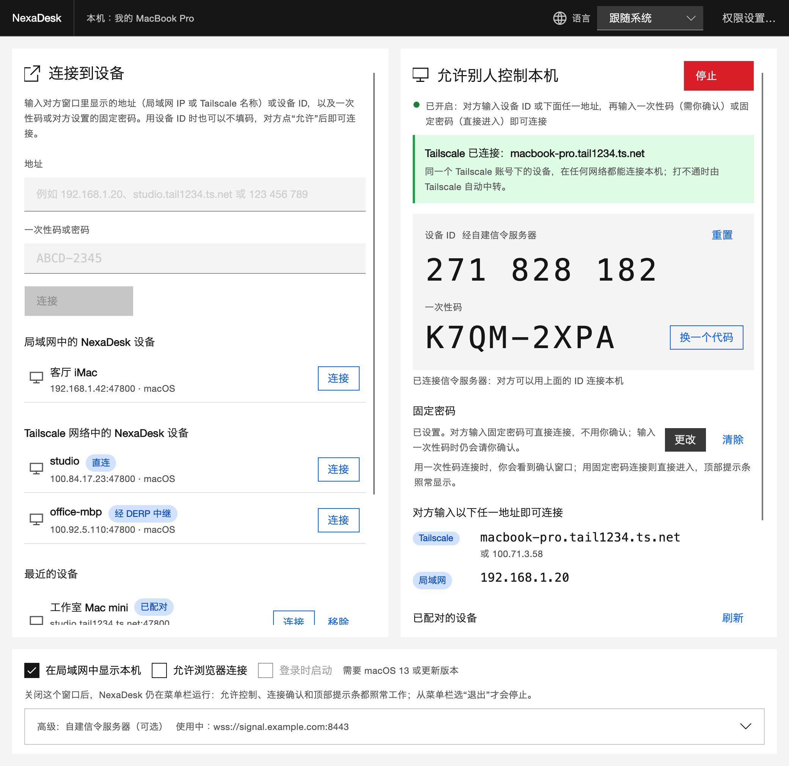
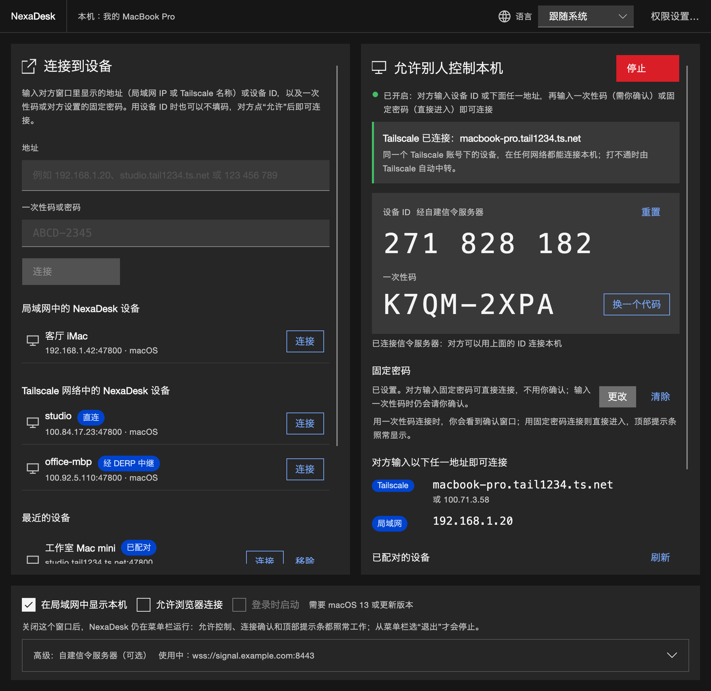
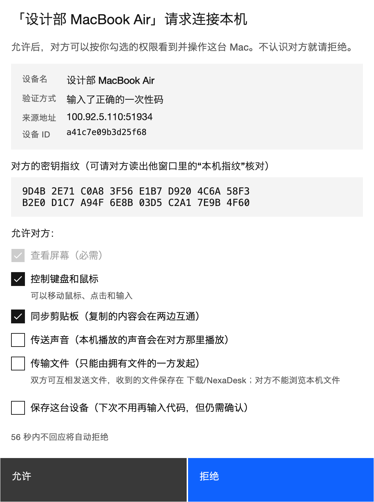
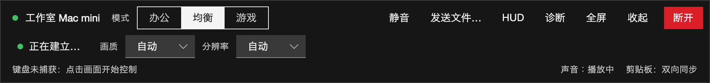

# NexaDesk

轻量的远程控制软件。目标是高清、低延迟，粘贴可靠，键盘对 Win / Mac 友好，能自己打洞，也能借助 Tailscale。界面用 Avalonia，后端用 Rust。

> **状态**：macOS ↔ macOS 的功能已经写完，自动化测试全部通过，但**还没在两台真实的 Mac、真实的网络上验证过**。Web 端（浏览器查看和控制，含手机、输入法、剪贴板，可经自建服务器跨网络）已实现，只用演示主机在 Chrome 中做过自动化端到端测试；Windows 端尚未开始。暂时不建议用在重要场合。

## 截图

主窗口：左边连接别的设备（局域网和 Tailscale 里的设备会自动列出），右边允许别人控制本机（对方可输入的地址、一次性码、已配对的设备）。自动跟随系统的浅色和深色。

<p>
  
  
</p>

有人连接时，本机弹出确认窗口：显示对方是谁、怎么验证的、密钥指纹，由你勾选允许的权限。“拒绝”是默认按钮，“允许”在窗口出现一秒后才能点。浏览器端不用安装任何软件，输入一次性码即可。

<p>
  
  
</p>

控制别人时，画面上方是工具栏（模式、声音、文件、HUD、诊断）；被控制时，本机顶部一直显示提示条，随时可以断开。

<p>
  <br>
  
</p>

截图里的设备、地址和代码都是虚构的。界面改动后运行 `scripts/screenshots.sh` 重新生成：应用界面由 `ui/NexaDesk.Screenshots` 用真实的界面代码离屏渲染，浏览器页面用无界面的 Google Chrome 截取。

## 特点

- **传输**：一个 UDP socket 上跑 QUIC。控制走可靠流，视频走 DATAGRAM，每帧带 Reed-Solomon 纠错。拥塞控制由应用层自己做，丢一个包不会卡住后面的帧。
- **连接，默认不用服务器**：
  - 局域网：mDNS 自动发现，直接连接。
  - 跨网络：**推荐 Tailscale**。两边登录同一个 Tailscale 账号即可互连，Tailscale 负责打洞，打不通时自动中转。NexaDesk 会列出 tailnet 里运行 NexaDesk 的设备，并标明是直连还是经 DERP 中转。
  - 可选的自建服务器：按 9 位设备 ID 连接，自己打洞（端口映射依次尝试 PCP、NAT-PMP、UPnP），打不通就走 UDP 中继，UDP 被封锁时走 WebSocket 中继。
- **画面**：macOS 用 ScreenCaptureKit 采集，VideoToolbox 硬件编码 HEVC / H.264，用低延迟码率控制和长期参考帧（LTR）。丢帧后只让失效的帧之后的画面重新参考，不必等关键帧。
- **键盘**：按物理键码传输，控制端改写组合键意图。例如在 Mac 上按 ⌘C 控制 Windows 时发出 Ctrl+C，而不是全局对调 Ctrl 和 Cmd。映射表可以编辑和预览。
- **剪贴板与粘贴**：按代际同步。远端粘贴前先等剪贴板到达对端，再放行粘贴键，避免粘贴出旧内容。
- **游戏模式**：锁定指针，发送相对移动；FEC 更强，延迟更低。
- **浏览器控制**：对方不用安装任何软件，用浏览器打开 `https://本机地址:47801`，输入一次性码即可查看和控制。页面和 WebRTC 都由本机提供，不需要服务器；适合局域网和 Tailscale。手机可用触控手势和屏幕键盘，输入法照常可用，文字剪贴板双向同步，非 Mac 键盘的 Ctrl+C/V 自动对应 ⌘C/V。有自建服务器时，也可以从任何网络打开服务器的网址、输入设备 ID 连接，画面经服务器的 TURN 中转。浏览器顶部显示连接方式和网络质量，画质可选自动、清晰、均衡、弱网。默认关闭，在主窗口底部打开“允许浏览器连接”。
- **多人同时连接**：最多 4 人同时连接同一台 Mac（应用和浏览器合计），各自确认、都能操作；每人一条顶部提示条，可单独断开，也可以收起成一个小标签。
- **命令行**：浏览器连接时可以选“屏幕”或“终端”。终端打开被控端的 shell（xterm.js），是单独一项权限，默认不勾。Linux 和 Windows 服务器用命令行被控端 `nexa-term-host`（PowerShell / bash），见 [docs/TERM_HOST.md](docs/TERM_HOST.md)。
- **其他**：光标形状、声音（Opus）、文件收发、多显示器、断线 30 秒内自动重连、HUD 与连接诊断。
- **多语言**：简体中文、English、日本語。默认跟随 macOS 的语言设置，也可以在主窗口右上角切换（重启后生效）。
- **安全**：
  - 双向 TLS，身份就是设备公钥。
  - 首次连接用一次性码或固定密码做 SPAKE2 配对，并绑定到 TLS 会话；之后钉住对方公钥。固定密码在“允许别人控制本机”下设置，只保存 Argon2id 的结果，和一次性码同时有效，原生端和浏览器都能用。
  - 每次被控都要本机确认（可对已配对设备设为无人值守），并显示提示条。
  - 配对猜测按来源限制。

## 仓库结构

| 路径 | 内容 |
|---|---|
| `crates/nexa-wire` | 线上格式：数据报、帧、控制消息、信令消息 |
| `crates/nexa-net` | 自定义 QUIC socket、拥塞与码率控制、FEC、STUN、打洞、路径管理、端口映射、Tailscale、mDNS |
| `crates/nexa-media` | 采集、编解码、呈现、光标、音频（macOS 实现） |
| `crates/nexa-input` | 组合键改写、键位表、输入捕获与注入 |
| `crates/nexa-clip` | 剪贴板同步与粘贴闸门 |
| `crates/nexa-auth` | 设备身份、配对、钉住、访问决策 |
| `crates/nexa-session` | 会话握手、被控端与控制端的会话逻辑、文件传输、重连、会合 |
| `crates/nexa-agent` | 被控端进程 `nexa-agent` |
| `crates/nexa-client` | 控制端动态库 `libnexa_client`（C ABI，供 UI 调用） |
| `crates/nexa-signal` | 信令 + STUN + 中继服务器 `nexa-signal` |
| `crates/nexa-web` | 浏览器访问：HTTPS、信令和 WebRTC（str0m），由被控端提供；经服务器的会话走 TURN |
| `crates/nexa-web-page` | 浏览器端网页，由被控端和信令服务器共用 |
| `crates/nexa-turn` | TURN 服务器与客户端（纯状态机），只在同一服务器的分配之间中转 |
| `crates/nexa-web-pake` | 浏览器一侧的配对（SPAKE2），编译为 WebAssembly |
| `ui/` | Avalonia 桌面应用（.NET 10，NativeAOT）、测试和 README 截图工具 |
| `deploy/` | 服务器的 systemd 单元、Docker 镜像与 Compose、配置模板、证书续期钩子 |
| `docs/` | 设计文档、部署说明、M0 验证报告 |
| `spikes/` | M0 阶段的验证代码 |

## 构建（macOS）

需要：

- macOS 14 或更高；
- Xcode 命令行工具；
- Rust stable（edition 2024）；
- .NET 10 SDK。

打包成一个应用：

```bash
scripts/package-macos.sh
```

产物是 `dist/NexaDesk.app`。默认是 ad-hoc 签名：每次重新打包，macOS 都会把它当成新应用，“屏幕录制”“辅助功能”权限和钥匙串的“始终允许”都要重新给。先运行一次下面的脚本，在登录钥匙串里建一个本机签名证书（“NexaDesk Local Signing”），之后每次打包都用它签名，macOS 会认为是同一个应用，给过的权限不会再丢：

```bash
scripts/make-signing-identity.sh
```

这个证书的私钥只应留在本机：拿到它的人可以签出被 macOS 当作 NexaDesk、带着同样权限的程序。给别人用的版本请用 Developer ID 签名（`NEXA_SIGN_IDENTITY="Developer ID Application: …" scripts/package-macos.sh`）。

应用图标在 `assets/icon/`（`AppIcon.icns` 和 1024 px 原图），已提交到仓库，打包时直接使用。图标由 `scripts/make-app-icon.swift` 用代码绘制；修改后运行 `scripts/make-app-icon.sh` 重新生成。

只编译 Rust 部分：

```bash
cargo build --release -p nexa-agent -p nexa-client
```

## 使用

1. 两台 Mac 都打开 NexaDesk.app，按提示授予“屏幕录制”和“辅助功能”权限，首次在局域网使用时还要允许“本地网络”。
2. 不在同一个局域网时，两台都安装 [Tailscale](https://tailscale.com/download) 并登录同一个账号。同一局域网内不需要。
3. 被控的一台点“允许别人控制本机”。默认监听所有网络，窗口里会列出对方可以输入的地址（Tailscale 名称、局域网 IP）和一次性码。
4. 控制的一台选择对方，然后输入一次性码：
   - 在“局域网中的 NexaDesk 设备”或“Tailscale 网络中的 NexaDesk 设备”里点“连接”；
   - 也可以手动输入对方的地址，例如 `192.168.1.20` 或 `studio.tail1234.ts.net`（默认端口 47800）。
5. 被控端确认后开始控制。配对过的设备下次可以直接连接。

不能用 Tailscale 时，可以自建信令服务器，按 9 位设备 ID 连接：部署方法见 [docs/DEPLOY.md](docs/DEPLOY.md)，然后在主窗口的“高级：自建信令服务器（可选）”里填写地址。

被控端也可以从命令行运行，在终端里确认连接：

```bash
nexa-agent --listen '[::]:47800'
```

`nexa-agent --help` 列出全部选项，例如 `--paired-only`、`--relay-only`、`--no-lan-discovery`。

## 测试

```bash
cargo test --workspace
```

```bash
dotnet test ui/NexaDesk.Tests
```

需要真实硬件或网络的测试默认忽略，例如真实组播、屏幕采集，以及会触发系统权限提示的测试。

试用浏览器端，不需要屏幕录制权限（合成画面，经真实 H.264 编码器；收到的鼠标和按键会画进画面）：

```bash
cargo run -p nexa-web --example demo
```

然后在另一台设备的浏览器，或本机浏览器，打开 `https://本机局域网地址:47801`（不要用 127.0.0.1），接受自签证书的提示，输入终端里显示的一次性码。按 F9 会让演示主机“复制”一行文字，可以用来试剪贴板。改了 `crates/nexa-web-pake` 之后，运行 `scripts/build-web-pake.sh` 重新生成 `crates/nexa-web-page/web/pake.wasm`。

## 文档

- [docs/DESIGN.md](docs/DESIGN.md)：总体设计与里程碑
- [docs/DETAILED_DESIGN.md](docs/DETAILED_DESIGN.md)：详细设计，各章末尾的“实现修订”记录了实际实现与设计的差异
- [docs/DEPLOY.md](docs/DEPLOY.md)：部署信令、STUN 和中继服务器
- [docs/WEB_CLIENT.md](docs/WEB_CLIENT.md)：Web 控制端的方案与第一版实现
- [docs/TERM_HOST.md](docs/TERM_HOST.md)：Linux / Windows 命令行被控端
- [docs/spikes/M0-report.md](docs/spikes/M0-report.md)：M0 验证报告

## 尚未完成

- **验证**：两台 Mac 的实机联调；真实 NAT 环境下的打洞测试（经自建服务器中继已在公网实测，见 docs/DEPLOY.md §6）。
- **macOS 发布**：Developer ID 签名与公证、安装包、自动更新，以及登录界面和锁屏前的远程访问。
- **其他平台**：Windows 的图形被控端与控制端（命令行被控端已有，见 docs/TERM_HOST.md）。
- **Web 端后续**：真实手机、Safari、Firefox 和公网环境下的实测与延迟；TURN over TCP/TLS（UDP 被封的网络）；声音和文件传输。
- **产品决定**：无人值守机器的首次配对方式；知道 ID 的人默认能做什么；文件权限是否按方向拆开。
