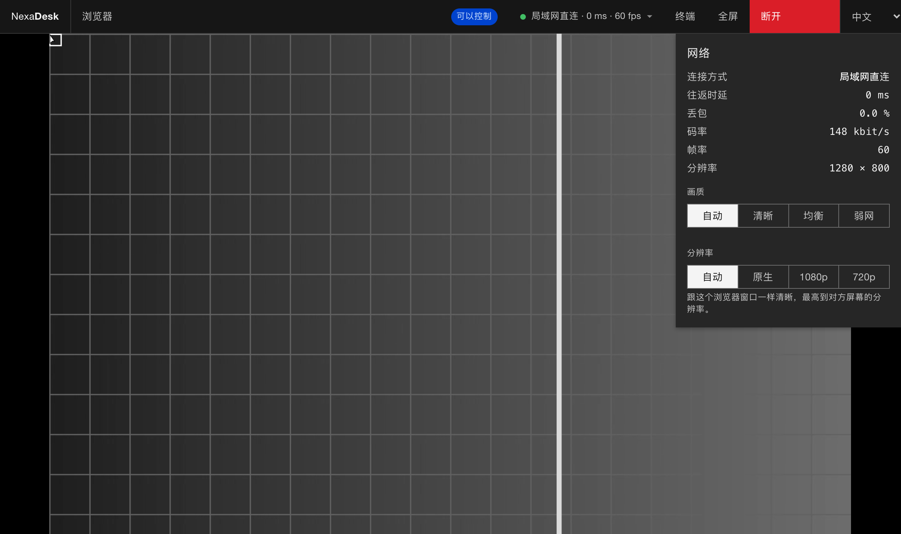
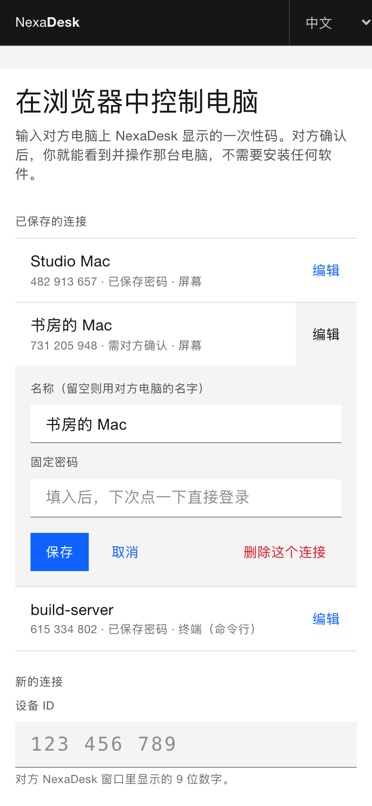
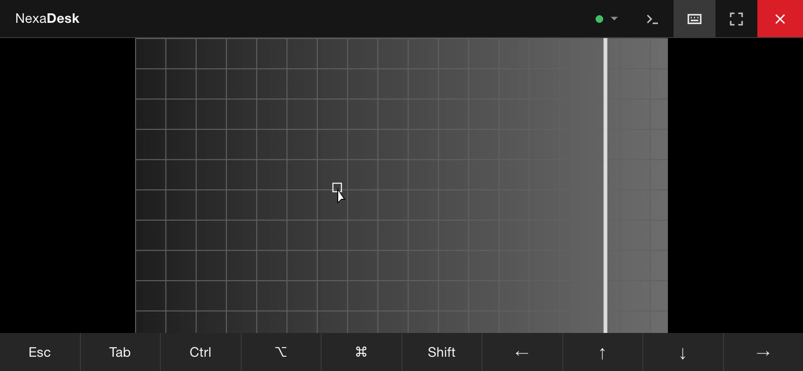
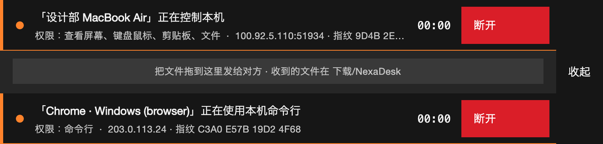

# NexaDesk

<p align="center">
  
</p>

<p align="center">
  Lightweight, low-latency remote control: a sharp picture, a keyboard for Mac and Windows, control from any browser
</p>

<p align="center">
  <a href="https://nexadesk-bq9.pages.dev/en/">Website</a> · <a href="https://github.com/dollarkillerx/NexaDesk/releases/latest">Download</a>
</p>

<p align="center">
  <strong>English</strong> | <a href="./README.zh-CN.md">简体中文</a> | <a href="./README.ja-JP.md">日本語</a>
</p>

## Features

- **Low-latency picture** - ScreenCaptureKit capture, VideoToolbox hardware HEVC / H.264 with low-latency rate control and long-term reference frames: after a loss only the frames that depend on it are re-referenced, no waiting for a keyframe. Wi-Fi radio stalls are told apart from congestion. A watched display does not sleep; a sleeping one is woken, as with Apple Screen Sharing.
- **Transport** - QUIC over one UDP socket: control on reliable streams, video in DATAGRAMs with Reed-Solomon error correction per frame, so one lost packet does not hold up the frames behind it.
- **Connecting, no server by default**
  - Local network: found over mDNS, connected directly.
  - Across networks: **Tailscale recommended**. Sign both machines in to the same Tailscale account; NexaDesk lists the tailnet's devices and shows whether a path is direct or relayed through DERP.
  - Your own server (optional): connect by a 9-digit device ID, with hole punching and port mapping (PCP, NAT-PMP, UPnP), then a UDP relay, and a WebSocket relay where UDP is blocked.
- **Keyboard for Mac and Windows** - Keys go by physical code and shortcuts by intent: ⌘C on a Mac controlling Windows sends Ctrl+C, without swapping Ctrl and Cmd everywhere. The mapping can be edited and previewed. Symbols come out as printed on your keyboard, so a Japanese keyboard controlling a US-layout Mac types the right characters.
- **Paste that is never stale** - The clipboard syncs by generation; a paste waits until the new content has reached the other side, also for large images still downloading. Text and images both sync.
- **Control from a browser** - Nothing to install on the other side.
  - On the LAN and Tailscale, open `https://host-address:47801`: the page and WebRTC come from the host itself, through no server.
  - With your own server, open its address from any network and type the device ID. Traffic starts over the server's TURN relay; once the host allows the connection, it shares its LAN and Tailscale addresses and the browser switches to a direct path when it can.
  - The pointer is drawn locally, so it moves without delay.
  - Saved devices reconnect with one tap; saved passwords are encrypted with a key the page cannot export, and one-time codes are never saved.
  - Phones: touch gestures, the on-screen keyboard, input methods, and a row of Esc, Tab, modifier and arrow keys.
  - Off by default: turn on "Allow browsers to connect" in the main window.
- **Command line** - Open just the host's shell, in the app (a native terminal control, the same on macOS and Windows) or in a browser (xterm.js). It is a separate permission, off by default, and the shell and everything it started end with the session. Linux and Windows machines without a desktop run the command-line host `nexa-term-host` (bash / PowerShell), see [docs/TERM_HOST.md](docs/TERM_HOST.md).
- **Several people at once** - Up to four people (app and browsers together) can connect to the same Mac, each allowed separately and each able to control; whoever leaves ends only their own session.
- **Sign-in** - A one-time code (the host allows it), a fixed password (the owner's own way in, no prompt), or through a server just the device ID, which the host sees as an unverified request. The device ID can be reset at any time.
- **Stays reachable** - Remote control is on when NexaDesk starts, also after "Restart to update", so updating a host from afar does not lock you out; once you stop it yourself, it stays off until you start it again. It can also start at login.
- **More** - Pointer shapes, sound (Opus), file transfer, several displays, game mode (locked pointer, stronger error correction), automatic reconnect within 30 seconds, HUD and connection diagnostics.
- **Multi-language** - English, Simplified Chinese, Japanese. Follows the system language; can be switched in the main window (applies after a restart).
- **Security**
  - Mutual TLS; a device's identity is its public key.
  - First contact pairs with SPAKE2 using a one-time code or the fixed password, bound to the TLS session; the peer's key is pinned from then on. The fixed password is kept only as an Argon2id hash.
  - The host confirms each connection (paired devices can be set to connect unattended; the fixed password goes straight in) and shows a banner the whole time.
  - Pairing guesses are limited per source.

## Screenshots

The main window: connect to other devices on the left (LAN and Tailscale devices are listed by themselves); allow remote control of this computer on the right, with the device ID and one-time code shown large (a click copies them), the fixed password and the addresses others can type. Follows light and dark mode.

<p>
  
  
</p>

When someone connects, the host asks: who it is, how they proved it, their key fingerprint, and which permissions to allow. "Deny" is the default button and "Allow" only works a second after the prompt appears. The browser viewer needs no install; pick "Screen" or "Terminal" when connecting, and save devices in the browser for one-tap reconnects.

<p>
  
  
</p>

The host's screen in a browser. The top bar shows the path, latency and frame rate; open it for loss and bitrate, quality and resolution, and whether symbols follow the printed key or the key's position. "Terminal" opens only the command line, with no picture.

<p>
  
  
</p>

On a phone the top bar turns into icons, landscape gives the picture more room, and the keyboard brings a row of Esc, Tab, modifier and arrow keys.

<p>
  
  
</p>

While controlling, the toolbar sits above the picture (mode, sound, files, HUD, diagnostics) and collapses into a small tab you can drag aside. While controlled, the host shows a banner at the top, a line per person, each with its own Disconnect; it folds into a small tab that can be moved, but never hides.

<p>
  <br>
  
  
</p>

<sub>Devices, addresses, codes and saved connections in the screenshots are made up. Regenerate them with `scripts/screenshots.sh` after UI changes: the app's windows are rendered off screen from the real UI code by `ui/NexaDesk.Screenshots`, and the browser pages are captured by `scripts/web-screenshots.mjs` in headless Google Chrome against a demo host (desktop and phone sizes).</sub>

## Download

From [GitHub Releases](https://github.com/dollarkillerx/NexaDesk/releases/latest) or the [website](https://nexadesk-bq9.pages.dev/en/):

- **macOS** (Apple silicon, macOS 14+): [NexaDesk-macOS.dmg](https://github.com/dollarkillerx/NexaDesk/releases/latest/download/NexaDesk-macOS.dmg). Signed with a Developer ID and notarized by Apple.
- **Windows** (x64, Windows 10 / 11): [NexaDesk-win-Setup.exe](https://github.com/dollarkillerx/NexaDesk/releases/latest/download/NexaDesk-win-Setup.exe). Installs per user, no administrator rights needed. Not code-signed yet: if SmartScreen appears, choose **More info → Run anyway**.

Both update themselves ([Velopack](https://velopack.io)): they check GitHub Releases at start and then daily, download a new version in the background and show "Restart to update" at the bottom of the main window. They never restart by themselves, since a restart drops remote sessions.

## Getting Started

1. Open NexaDesk on both Macs and grant Screen Recording and Accessibility when asked (and Local Network the first time on a LAN).
2. Not on the same network? Install [Tailscale](https://tailscale.com/download) on both and sign in to the same account.
3. On the host, under "Allow remote control", click Start. It listens on all networks by default and lists the addresses others can type (Tailscale name, LAN IP) and a one-time code.
4. On the viewer, pick the host and type the one-time code:
   - click Connect under "NexaDesk devices on the local network" or "NexaDesk devices on your Tailscale network";
   - or type its address, e.g. `192.168.1.20` or `studio.tail1234.ts.net` (default port 47800).
5. Control starts once the host allows it. A paired device connects directly next time.

Without Tailscale, run your own signaling server and connect by 9-digit device ID. See [Self-hosting a signaling server](#self-hosting-a-signaling-server) below.

Set a **fixed password** on the host to go straight in without a prompt, for your own computers.

Linux or Windows machines without a desktop: build the command-line host with `scripts/build-term-host.sh`, run `nexa-term-host --signal wss://your-server:8443`, then open the server's address in a browser, choose "Terminal" and type the device ID it prints. See [docs/TERM_HOST.md](docs/TERM_HOST.md).

The host can also run from the command line and confirm connections in the terminal:

```bash
nexa-agent --listen '[::]:47800'
```

`nexa-agent --help` lists every option, e.g. `--paired-only`, `--relay-only`, `--no-lan-discovery`.

Why did a connection end? NexaDesk.app writes the host's log to `~/Library/Logs/NexaDesk/agent.log`: each session's start, end and reason, and every 5 seconds a line of stream statistics (frames, bitrate, target, Wi-Fi stalls). Past 1 MB the old log moves to `agent.log.1`.

## Self-hosting a signaling server

`nexa-signal` is one process: signaling (device IDs), STUN, a UDP/WebSocket relay for networks that cannot connect directly, and optionally the browser page. Screen, input and clipboard stay end-to-end encrypted; the server never sees them. You need a Linux machine (x86_64, systemd) with a public IPv4 address, and root.

```bash
curl -fsSL https://raw.githubusercontent.com/dollarkillerx/NexaDesk/main/deploy/install.sh | sudo sh
```

The script downloads the program (and checks its SHA-256), picks a random **signaling key**, makes a certificate, installs and starts the service, opens ufw/firewalld, and prints the server address, the key and the certificate fingerprint. Run it again to upgrade; your configuration is kept. Useful options (after `sh -s --`): `--host <ip or domain>`, `--port <n>`, `--web [password]` (also serve the browser page; the password is optional), `--key <key>`. Look at the result again with `sh install.sh --show`.

Then, on every Mac or PC that should use the server, open "Advanced" in the main window, enter the server address and the key (a signaling server always needs its key), and Save. Stop and start "Allow remote control" once so the host registers. The first connection to a server with a private certificate asks you to check its fingerprint and trust it.

Also open TCP 443 (or your port) and UDP 3478 and 3480 in your cloud provider's security group. For a public domain with a normal certificate, use `--host your.domain` and see [docs/DEPLOY.md](docs/DEPLOY.md), which also covers manual and Docker installs, key rotation and operations.

**Offering a server to everyone.** `servers.json` in this repository lists servers with their keys. In "Advanced", the switch "Pick from the published server list" (off by default) loads it, and choosing an entry fills in its address and key. The keys there are public; they only keep out people who do not know the list.

## Build from Source

Prerequisites: macOS 14+, Xcode command-line tools, Rust stable (edition 2024), [.NET 10 SDK](https://dotnet.microsoft.com/download/dotnet/10.0).

```bash
git clone https://github.com/dollarkillerx/NexaDesk.git
cd NexaDesk

scripts/package-macos.sh                              # the app: dist/NexaDesk.app
cargo build --release -p nexa-agent -p nexa-client    # Rust only
```

By default the app is signed ad hoc, so macOS treats every new build as a new app and asks again for Screen Recording, Accessibility and Keychain access. Run this once to create a local signing certificate ("NexaDesk Local Signing") in the login keychain; later builds use it and keep their permissions:

```bash
scripts/make-signing-identity.sh
```

Keep that certificate's private key on this Mac only: whoever has it can sign programs macOS treats as NexaDesk, with the same permissions. With a Developer ID Application certificate in the keychain, the script uses that instead and turns on the hardened runtime (needed for notarization).

The app icon is in `assets/icon/`, drawn in code by `scripts/make-app-icon.swift`; run `scripts/make-app-icon.sh` after changing it.

### Releasing

Package both platforms on a Mac, then upload every file in `dist/macos/` and `dist/windows/` to one GitHub Release (the updater reads `releases.osx.json` / `releases.win.json` from the latest release):

```bash
NEXA_NOTARY_PROFILE=<notarytool profile> scripts/package-macos.sh
scripts/package-windows.sh
```

The version comes from `<Version>` in `ui/NexaDesk.App/NexaDesk.App.csproj`. The Windows package is cross-compiled with mingw, see [docs/WINDOWS.md](docs/WINDOWS.md).

### Tests

```bash
cargo test --workspace
dotnet test ui/NexaDesk.Tests
```

Tests that need real hardware or networks are ignored by default (real multicast, screen capture, anything that brings up a system permission prompt).

To try the browser viewer without Screen Recording (a synthetic picture through the real H.264 encoder; the mouse and keys it receives are drawn into it):

```bash
cargo run -p nexa-web --example demo
```

Then open `https://this-mac's-LAN-address:47801` (not 127.0.0.1) in a browser, accept the self-signed certificate and type the one-time code shown in the terminal. F9 makes the demo host "copy" a line of text, to try the clipboard. After changing `crates/nexa-web-pake`, run `scripts/build-web-pake.sh` to rebuild `crates/nexa-web-page/web/pake.wasm`.

## Repository Layout

| Path | Contents |
|---|---|
| `crates/nexa-wire` | Wire formats: datagrams, frames, control and signaling messages |
| `crates/nexa-net` | QUIC socket, congestion and rate control, FEC, STUN, hole punching, path management, port mapping, Tailscale, mDNS |
| `crates/nexa-media` | Capture, encode / decode, presentation, cursor, audio (macOS and Windows) |
| `crates/nexa-input` | Shortcut rewriting, keymaps, input capture and injection |
| `crates/nexa-clip` | Clipboard sync and the paste gate |
| `crates/nexa-auth` | Device identity, pairing, pinning, access decisions |
| `crates/nexa-session` | Session handshake, host and viewer session logic, file transfer, reconnect, rendezvous |
| `crates/nexa-agent` | The host process `nexa-agent` |
| `crates/nexa-client` | The viewer library `libnexa_client` (C ABI for the UI) |
| `crates/nexa-signal` | Signaling + STUN + relay server `nexa-signal` |
| `crates/nexa-web` | Browser access: HTTPS, signaling and WebRTC (str0m), served by the host; TURN through a server |
| `crates/nexa-web-page` | The browser page, shared by the host and the signaling server |
| `crates/nexa-turn` | TURN server and client (pure state machines), relaying only between allocations on one server |
| `crates/nexa-web-pake` | The browser side of pairing (SPAKE2), compiled to WebAssembly |
| `crates/nexa-term` | A shell on a pseudo-terminal (PTY on Linux / macOS, ConPTY on Windows); the whole process tree ends with the session |
| `crates/nexa-term-host` | The command-line host `nexa-term-host` for Linux and Windows servers |
| `ui/` | The Avalonia desktop app (.NET 10), the terminal control (`NexaDesk.Terminal`), tests and the README screenshot tool |
| `deploy/` | Server systemd units, Docker image and Compose, config templates, certificate renewal hook |
| `docs/` | Design documents, deployment, the M0 validation report |
| `spikes/` | M0 validation code |
| `third_party/` | Lightly patched third-party code (dimpl, so the Linux build needs no aws-lc), see its README |

## Documentation

- [docs/DESIGN.md](docs/DESIGN.md): overall design and milestones
- [docs/DETAILED_DESIGN.md](docs/DETAILED_DESIGN.md): detailed design; each chapter ends with how the implementation differs
- [docs/DEPLOY.md](docs/DEPLOY.md): deploying the signaling, STUN and relay server
- [docs/WEB_CLIENT.md](docs/WEB_CLIENT.md): the browser viewer
- [docs/TERM_HOST.md](docs/TERM_HOST.md): the Linux / Windows command-line host
- [docs/WINDOWS.md](docs/WINDOWS.md): the Windows port
- [docs/spikes/M0-report.md](docs/spikes/M0-report.md): M0 validation report

The design documents are in Chinese.

## Not Done Yet

- **Validation**: hole punching on real NATs (relaying through your own server is tested over the public internet, see docs/DEPLOY.md §7).
- **macOS**: remote access at the login window and lock screen.
- **Windows**: the many problems found on real hardware, in both the host and the viewer; the host's pointer shape on the viewer, HEVC, sound, running as a service (login screen and UAC), see [docs/WINDOWS.md](docs/WINDOWS.md).
- **Browser**: testing on iPhone / Safari and Firefox (Chrome on Android is in use); TURN over TCP/TLS for networks that block UDP; sound and file transfer.
- **Command-line host**: running the Windows build on real hardware; running as a Windows service.
- **Product decisions**: how an unattended machine is first paired; what someone who only knows the ID may do; whether file permission is split by direction.
