# NexaDesk

<p align="center">
  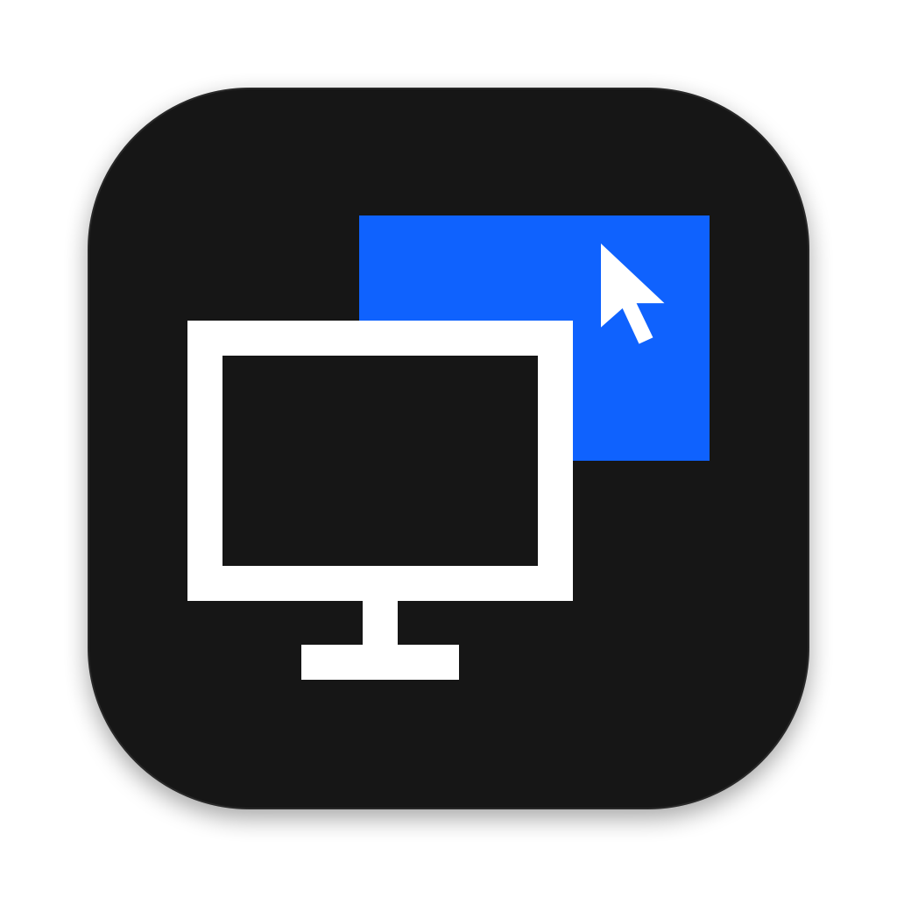
</p>

<p align="center">
  轻量、低延迟的远程控制软件：画面清晰，键盘对 Mac 和 Windows 都友好，浏览器也能直接控制
</p>

<p align="center">
  <a href="https://nexadesk-bq9.pages.dev/">官网</a> · <a href="https://github.com/dollarkillerx/NexaDesk/releases/latest">下载</a>
</p>

<p align="center">
  <a href="./README.md">English</a> | <strong>简体中文</strong> | <a href="./README.ja-JP.md">日本語</a>
</p>

> **状态**：**macOS 版是正式版**，已在两台 Mac 之间日常使用并验证。浏览器端（查看、控制、命令行，含手机，可经自建服务器跨网络）已在 Chrome 中做过自动化端到端测试，并经公网服务器实测。**Windows 版也是正式版**，已在实机上验证两个方向：被 Mac 或浏览器控制，以及控制 Mac。

## 功能特性

- **低延迟画面** - ScreenCaptureKit 采集，VideoToolbox 硬件编码 HEVC / H.264，用低延迟码率控制和长期参考帧（LTR）：丢帧后只让失效帧之后的画面重新参考，不必等关键帧。能区分 Wi‑Fi 的短暂中断和网络拥堵。有人连着时被控端的显示器不会因空闲关闭；显示器已睡着时会先唤醒，和 Apple 屏幕共享一样。
- **传输** - 一个 UDP socket 上跑 QUIC：控制走可靠流，视频走 DATAGRAM，每帧带 Reed-Solomon 纠错，丢一个包不会卡住后面的帧。
- **连接，默认不用服务器**
  - 局域网：mDNS 自动发现，直接连接。
  - 跨网络：**推荐 Tailscale**。两边登录同一个 Tailscale 账号即可互连；NexaDesk 会列出 tailnet 里的设备，并标明是直连还是经 DERP 中转。
  - 可选的自建服务器：按 9 位设备 ID 连接，先打洞和端口映射（PCP、NAT-PMP、UPnP），打不通走 UDP 中继，UDP 被封锁时走 WebSocket 中继。
- **对 Mac 和 Windows 都友好的键盘** - 按物理键码传输，按意图改写组合键：在 Mac 上按 ⌘C 控制 Windows 时发出 Ctrl+C，而不是全局对调 Ctrl 和 Cmd。映射表可以编辑和预览。符号默认按控制端键盘上印的字输入，两边布局不同时（比如日文键盘控制英文配列的 Mac）也不会打错。
- **粘贴不会出错** - 剪贴板按代际同步；粘贴会等新内容到达对端再放行，大图还在下载时也一样，不会粘出旧内容。文字和图片都能同步。
- **浏览器控制** - 对方不用安装任何软件。
  - 局域网和 Tailscale 里，用浏览器打开 `https://本机地址:47801`，页面和 WebRTC 都由本机提供，不经过服务器。
  - 有自建服务器时，从任何网络打开服务器网址、输入设备 ID 连接。先经服务器的 TURN 中转；本机允许之后才把局域网和 Tailscale 地址告诉浏览器，能直连时自动切换。
  - 指针在浏览器本地画，移动没有延迟。
  - 连过的设备保存在浏览器里，点一下就能再连；密码用页面也导不出的密钥加密保存，一次性码从不保存。
  - 手机可用：触控手势、屏幕键盘、输入法，以及一排 Esc、Tab、修饰键和方向键。
  - 默认关闭，在主窗口打开"允许浏览器连接"。
- **命令行** - 只打开对方的 shell：应用里用原生终端控件（macOS 和 Windows 相同），浏览器里用 xterm.js。这是单独一项权限，默认不勾；会话结束时 shell 和它启动的所有进程一起结束。没有图形界面的 Linux / Windows 机器用命令行被控端 `nexa-term-host`（bash / PowerShell），见 [docs/TERM_HOST.md](docs/TERM_HOST.md)。
- **多人同时连接** - 最多 4 人同时连接同一台 Mac（应用和浏览器合计），每人单独确认，都能操作，互不顶替；谁离开就只结束谁的会话。
- **登录方式** - 一次性码（对方点允许）；固定密码（机主自己的入口，不弹确认）；经服务器时也可以只填设备 ID，对方会看到标明"无法核实身份"的请求。设备 ID 可以随时重置。
- **随时能连上** - NexaDesk 启动时（包括"重启以更新"之后）自动开启"允许别人控制本机"，远程更新被控端不会把自己关在外面；自己点"停止"后保持关闭，直到再点"开始"。也可以设为登录时启动。
- **其他** - 光标形状、声音（Opus）、文件收发、多显示器、游戏模式（锁定指针、更强纠错）、断线 30 秒内自动重连、HUD 与连接诊断。
- **多语言** - English、简体中文、日本語。默认跟随系统语言，也可以在主窗口切换（重启后生效）。
- **安全**
  - 双向 TLS，身份就是设备公钥。
  - 首次连接用一次性码或固定密码做 SPAKE2 配对，并绑定到 TLS 会话；之后钉住对方公钥。固定密码只保存 Argon2id 的结果。
  - 被控时本机要确认（可对已配对设备设为无人值守；固定密码直接进入），并一直显示提示条。
  - 配对猜测按来源限制。

## 截图

主窗口：左边连接别的设备（局域网和 Tailscale 里的设备会自动列出），右边允许别人控制本机：放大显示的设备 ID 和一次性码（点一下就复制）、固定密码和对方可输入的地址。自动跟随系统的浅色和深色。

<p>
  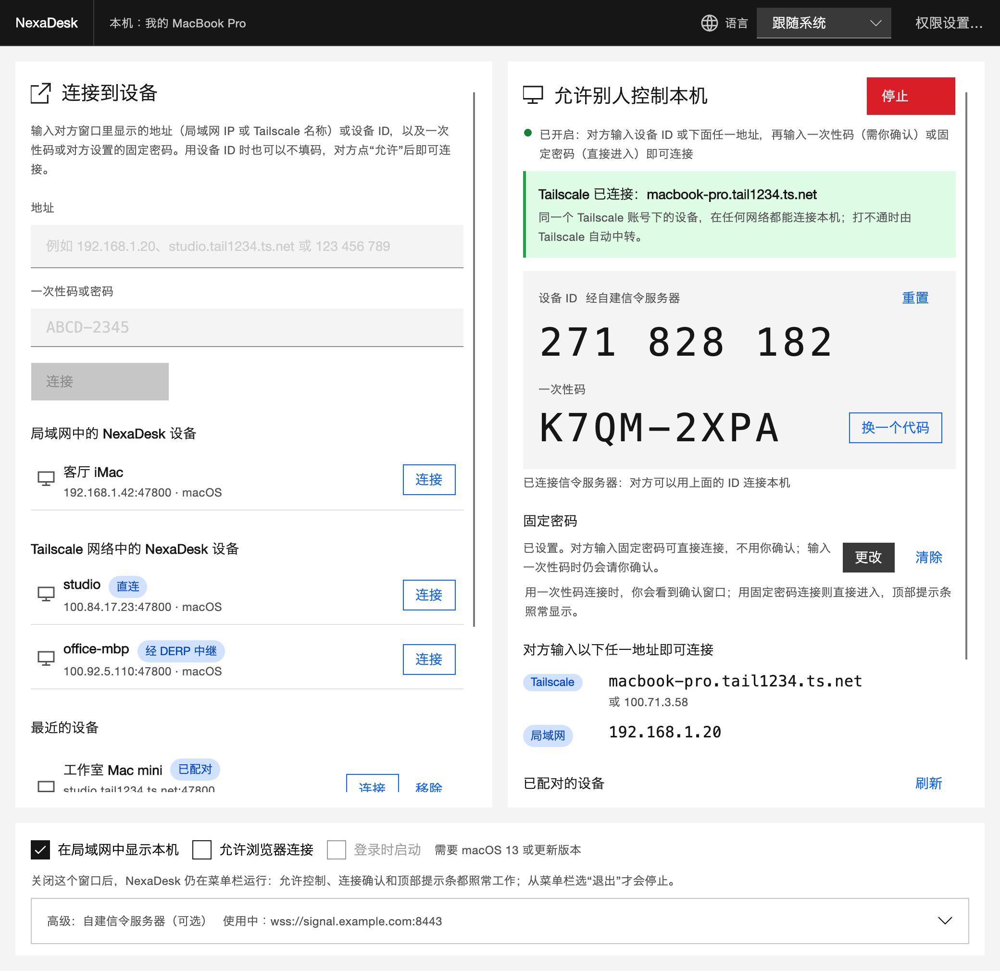
  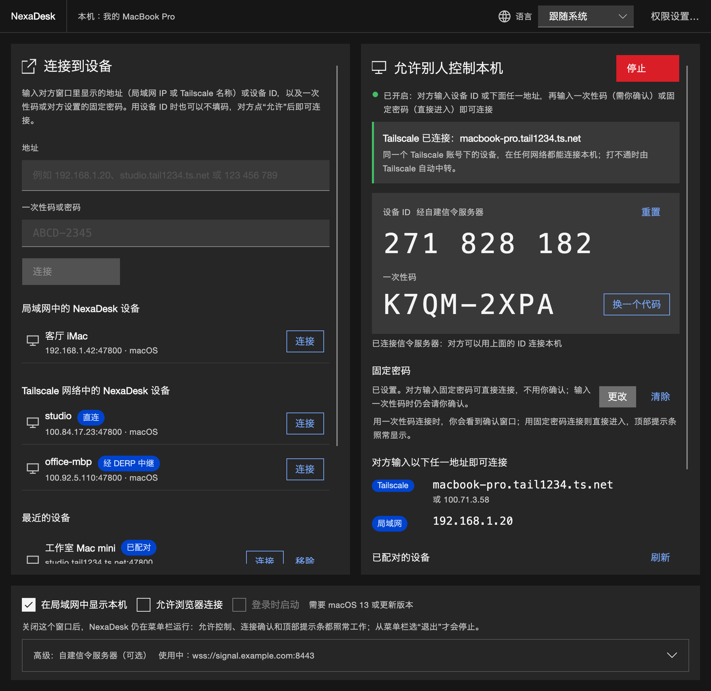
</p>

有人连接时，本机弹出确认窗口：显示对方是谁、怎么验证的、密钥指纹，由你勾选允许的权限。"拒绝"是默认按钮，"允许"在窗口出现一秒后才能点。浏览器端不用安装任何软件，连接时可以选"屏幕"或"终端"；连过的设备可以保存在浏览器里，下次点一下就能连上。

<p>
  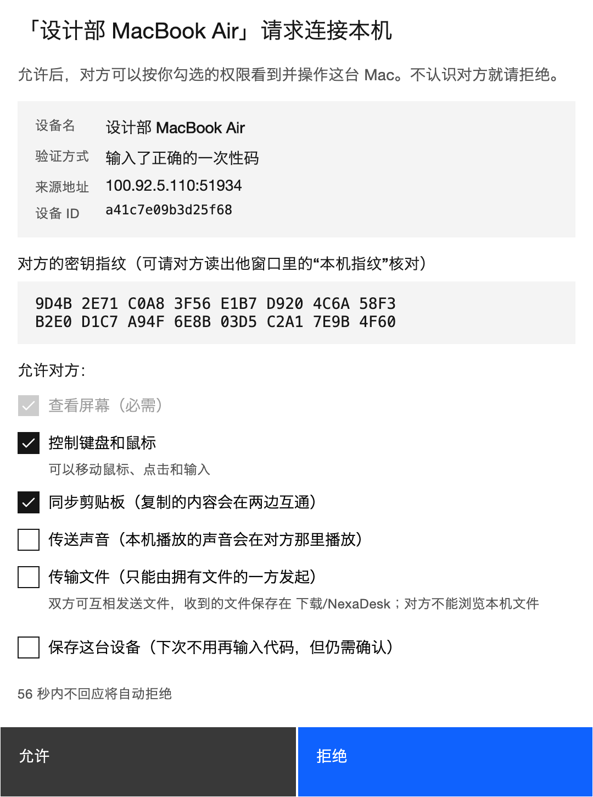
  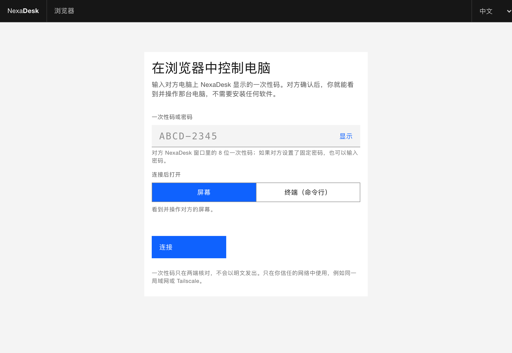
</p>

浏览器里看到并操作对方的屏幕。顶栏显示连接方式、延迟和帧率；展开后可以看丢包和码率，切换画质和分辨率，以及符号键按键上的字还是按位置输入。选"终端"时只打开对方的命令行，不传画面。

<p>
  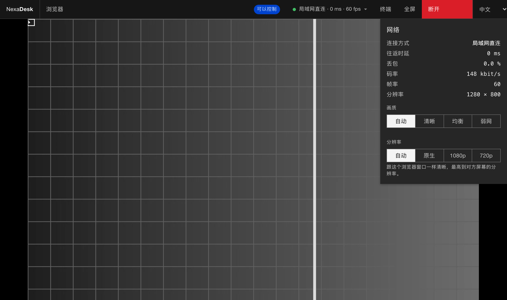
  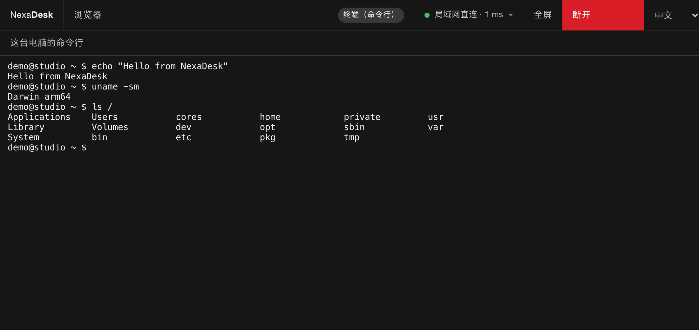
</p>

手机上顶栏换成图标，横屏时给画面让出更多空间，弹出键盘时多一排 Esc、Tab、修饰键和方向键。

<p>
  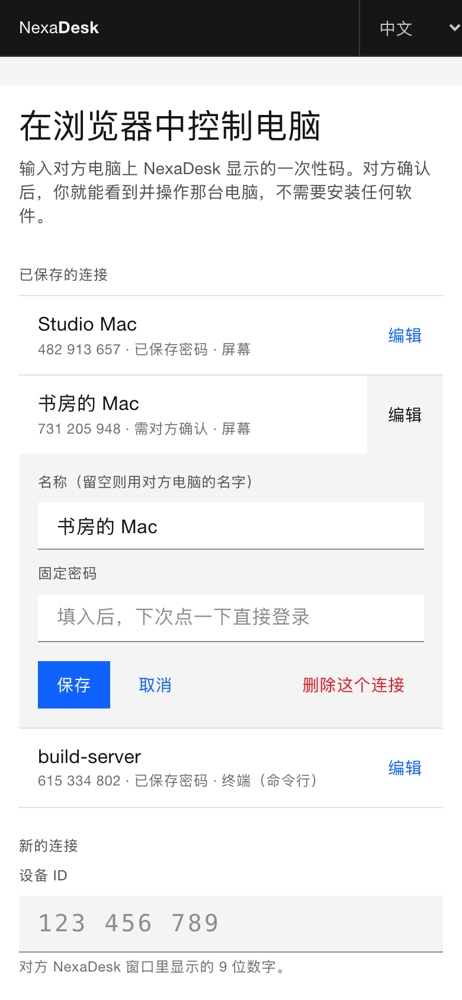
  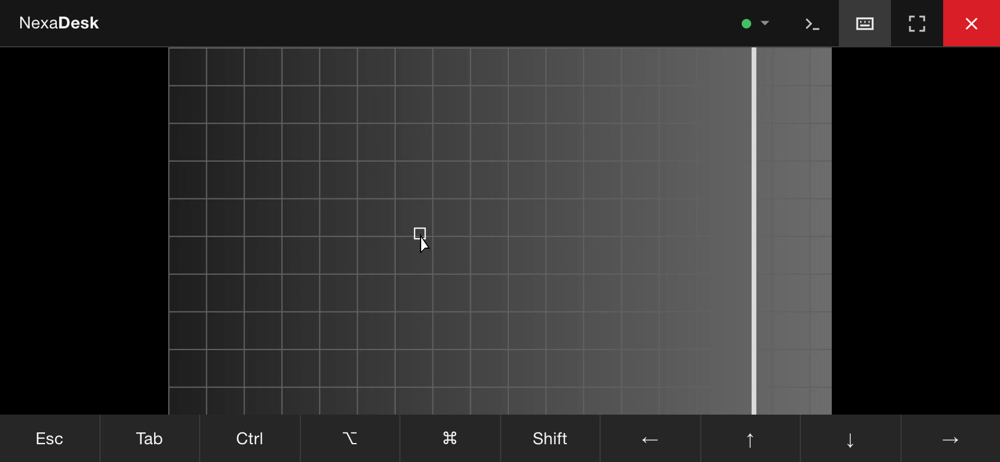
</p>

控制别人时，画面上方是工具条（模式、声音、文件、HUD、诊断），可以收起成一个能拖到一边的小标签。被控制时，本机顶部一直显示提示条，每个连接的人一行，可以单独断开；可以收起成一个能移动的小标签，但不会完全隐藏。

<p>
  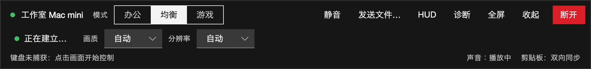<br>
  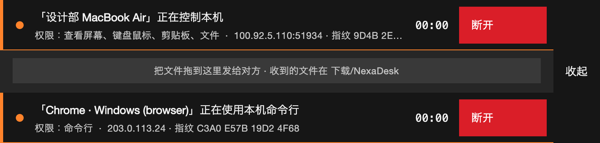
  
</p>

<sub>截图里的设备、地址、代码和已保存的连接都是虚构的。界面改动后运行 `scripts/screenshots.sh` 重新生成：应用界面由 `ui/NexaDesk.Screenshots` 用真实的界面代码离屏渲染；浏览器页面由 `scripts/web-screenshots.mjs` 在无界面的 Google Chrome 里对演示主机截取（电脑和手机尺寸各一遍）。</sub>

## 下载

从 [GitHub Releases](https://github.com/dollarkillerx/NexaDesk/releases/latest) 或[官网](https://nexadesk-bq9.pages.dev/)下载：

- **macOS**（Apple 芯片，macOS 14+）：[NexaDesk-macOS.dmg](https://github.com/dollarkillerx/NexaDesk/releases/latest/download/NexaDesk-macOS.dmg)，Developer ID 签名并经 Apple 公证。
- **Windows**（x64，Windows 10 / 11）：[NexaDesk-win-Setup.exe](https://github.com/dollarkillerx/NexaDesk/releases/latest/download/NexaDesk-win-Setup.exe)，按用户安装，不需要管理员权限；还没有代码签名，SmartScreen 提示时点**更多信息 → 仍要运行**。

两个版本都会自动更新（[Velopack](https://velopack.io)）：启动后和之后每天检查一次 GitHub Releases，有新版本就在后台下载，主窗口底部显示"重启以更新"。不会自动重启，因为重启会断开远程连接。

## 使用

1. 两台 Mac 都打开 NexaDesk，按提示授予"屏幕录制"和"辅助功能"权限，首次在局域网使用时还要允许"本地网络"。
2. 不在同一个局域网时，两台都安装 [Tailscale](https://tailscale.com/download) 并登录同一个账号。
3. 被控的一台在"允许别人控制本机"里点"开始"。默认监听所有网络，窗口里会列出对方可以输入的地址（Tailscale 名称、局域网 IP）和一次性码。
4. 控制的一台选择对方，然后输入一次性码：
   - 在"局域网中的 NexaDesk 设备"或"Tailscale 网络中的 NexaDesk 设备"里点"连接"；
   - 也可以手动输入对方的地址，例如 `192.168.1.20` 或 `studio.tail1234.ts.net`（默认端口 47800）。
5. 被控端确认后开始控制。配对过的设备下次可以直接连接。

不能用 Tailscale 时，可以自建信令服务器，按 9 位设备 ID 连接：部署方法见 [docs/DEPLOY.md](docs/DEPLOY.md)，然后在主窗口的"高级：自建信令服务器（可选）"里填写地址。

被控端可以设一个**固定密码**：用它连接时直接进入，不弹确认窗口，适合连自己的电脑。

没有图形界面的 Linux 或 Windows 机器，用命令行被控端：`scripts/build-term-host.sh` 构建，`nexa-term-host --signal wss://你的服务器:8443` 运行，然后在浏览器里打开服务器网址、选"终端"、输入它打印的设备 ID。详见 [docs/TERM_HOST.md](docs/TERM_HOST.md)。

被控端也可以从命令行运行，在终端里确认连接：

```bash
nexa-agent --listen '[::]:47800'
```

`nexa-agent --help` 列出全部选项，例如 `--paired-only`、`--relay-only`、`--no-lan-discovery`。

想知道连接为什么断开：NexaDesk.app 把被控端的日志写在 `~/Library/Logs/NexaDesk/agent.log`，里面有每个会话的开始、结束和原因，以及每 5 秒一行的码率统计（帧数、码率、目标、Wi‑Fi 中断）。超过 1 MB 时旧的移到 `agent.log.1`。

## 从源码构建

需要：macOS 14+、Xcode 命令行工具、Rust stable（edition 2024）、[.NET 10 SDK](https://dotnet.microsoft.com/download/dotnet/10.0)。

```bash
git clone https://github.com/dollarkillerx/NexaDesk.git
cd NexaDesk

scripts/package-macos.sh                              # 打包应用：dist/NexaDesk.app
cargo build --release -p nexa-agent -p nexa-client    # 只编译 Rust 部分
```

默认是 ad-hoc 签名：每次重新打包，macOS 都会把它当成新应用，"屏幕录制""辅助功能"权限和钥匙串的"始终允许"都要重新给。先运行一次下面的脚本，在登录钥匙串里建一个本机签名证书（"NexaDesk Local Signing"），之后每次打包都用它签名，给过的权限不会再丢：

```bash
scripts/make-signing-identity.sh
```

这个证书的私钥只应留在本机：拿到它的人可以签出被 macOS 当作 NexaDesk、带着同样权限的程序。钥匙串里有 Developer ID Application 证书时，脚本会优先用它，并开启 hardened runtime（公证需要）。

应用图标在 `assets/icon/`，由 `scripts/make-app-icon.swift` 用代码绘制；修改后运行 `scripts/make-app-icon.sh` 重新生成。

### 发布

在 Mac 上打两个平台的包，然后把 `dist/macos/` 和 `dist/windows/` 里的文件全部上传到同一个 GitHub Release（更新程序从最新的 Release 读 `releases.osx.json` / `releases.win.json`）：

```bash
NEXA_NOTARY_PROFILE=<notarytool 凭据名> scripts/package-macos.sh
scripts/package-windows.sh
```

版本号来自 `ui/NexaDesk.App/NexaDesk.App.csproj` 的 `<Version>`。Windows 包用 mingw 交叉编译，见 [docs/WINDOWS.md](docs/WINDOWS.md)。

### 测试

```bash
cargo test --workspace
dotnet test ui/NexaDesk.Tests
```

需要真实硬件或网络的测试默认忽略，例如真实组播、屏幕采集，以及会触发系统权限提示的测试。

试用浏览器端，不需要屏幕录制权限（合成画面，经真实 H.264 编码器；收到的鼠标和按键会画进画面）：

```bash
cargo run -p nexa-web --example demo
```

然后在浏览器里打开 `https://本机局域网地址:47801`（不要用 127.0.0.1），接受自签证书的提示，输入终端里显示的一次性码。按 F9 会让演示主机"复制"一行文字，可以用来试剪贴板。改了 `crates/nexa-web-pake` 之后，运行 `scripts/build-web-pake.sh` 重新生成 `crates/nexa-web-page/web/pake.wasm`。

## 仓库结构

| 路径 | 内容 |
|---|---|
| `crates/nexa-wire` | 线上格式：数据报、帧、控制消息、信令消息 |
| `crates/nexa-net` | 自定义 QUIC socket、拥塞与码率控制、FEC、STUN、打洞、路径管理、端口映射、Tailscale、mDNS |
| `crates/nexa-media` | 采集、编解码、呈现、光标、音频（macOS 和 Windows） |
| `crates/nexa-input` | 组合键改写、键位表、输入捕获与注入 |
| `crates/nexa-clip` | 剪贴板同步与粘贴闸门 |
| `crates/nexa-auth` | 设备身份、配对、钉住、访问决策 |
| `crates/nexa-session` | 会话握手、被控端与控制端的会话逻辑、文件传输、重连、会合 |
| `crates/nexa-agent` | 被控端进程 `nexa-agent` |
| `crates/nexa-client` | 控制端动态库 `libnexa_client`（C ABI，供 UI 调用） |
| `crates/nexa-signal` | 信令 + STUN + 中继服务器 `nexa-signal` |
| `crates/nexa-web` | 浏览器访问：HTTPS、信令和 WebRTC（str0m），由被控端提供；经服务器的会话走 TURN |
| `crates/nexa-web-page` | 浏览器端网页，由被控端和信令服务器共用 |
| `crates/nexa-turn` | TURN 服务器与客户端（纯状态机），只在同一服务器的分配之间中转 |
| `crates/nexa-web-pake` | 浏览器一侧的配对（SPAKE2），编译为 WebAssembly |
| `crates/nexa-term` | 伪终端上的 shell（Linux / macOS 用 PTY，Windows 用 ConPTY），随会话结束整个进程树 |
| `crates/nexa-term-host` | 只有命令行的被控端 `nexa-term-host`，用于 Linux、Windows 服务器 |
| `ui/` | Avalonia 桌面应用（.NET 10）、终端控件（`NexaDesk.Terminal`）、测试和 README 截图工具 |
| `deploy/` | 服务器的 systemd 单元、Docker 镜像与 Compose、配置模板、证书续期钩子 |
| `docs/` | 设计文档、部署说明、M0 验证报告 |
| `spikes/` | M0 阶段的验证代码 |
| `third_party/` | 打了小补丁的第三方代码（dimpl，让 Linux 版不依赖 aws-lc），说明见其中的 README |

## 文档

- [docs/DESIGN.md](docs/DESIGN.md)：总体设计与里程碑
- [docs/DETAILED_DESIGN.md](docs/DETAILED_DESIGN.md)：详细设计，各章末尾的"实现修订"记录了实际实现与设计的差异
- [docs/DEPLOY.md](docs/DEPLOY.md)：部署信令、STUN 和中继服务器
- [docs/WEB_CLIENT.md](docs/WEB_CLIENT.md)：浏览器控制端
- [docs/TERM_HOST.md](docs/TERM_HOST.md)：Linux / Windows 命令行被控端
- [docs/WINDOWS.md](docs/WINDOWS.md)：Windows 版
- [docs/spikes/M0-report.md](docs/spikes/M0-report.md)：M0 验证报告

## 尚未完成

- **验证**：真实 NAT 环境下的打洞测试（经自建服务器中继已在公网实测，见 docs/DEPLOY.md §6）。
- **macOS**：登录界面和锁屏前的远程访问。
- **Windows**：实机测试中发现的不少问题（被控端和控制端都有）；控制端显示对方的指针形状、HEVC、声音、作为服务运行（登录界面和 UAC），见 [docs/WINDOWS.md](docs/WINDOWS.md)。
- **浏览器端**：iPhone / Safari、Firefox 上的实测（Android 上的 Chrome 已在用）；TURN over TCP/TLS（UDP 被封的网络）；声音和文件传输。
- **命令行被控端**：Windows 版的实机运行；作为 Windows 服务运行。
- **产品决定**：无人值守机器的首次配对方式；知道 ID 的人默认能做什么；文件权限是否按方向拆开。
