# NexaDesk

<p align="center">
  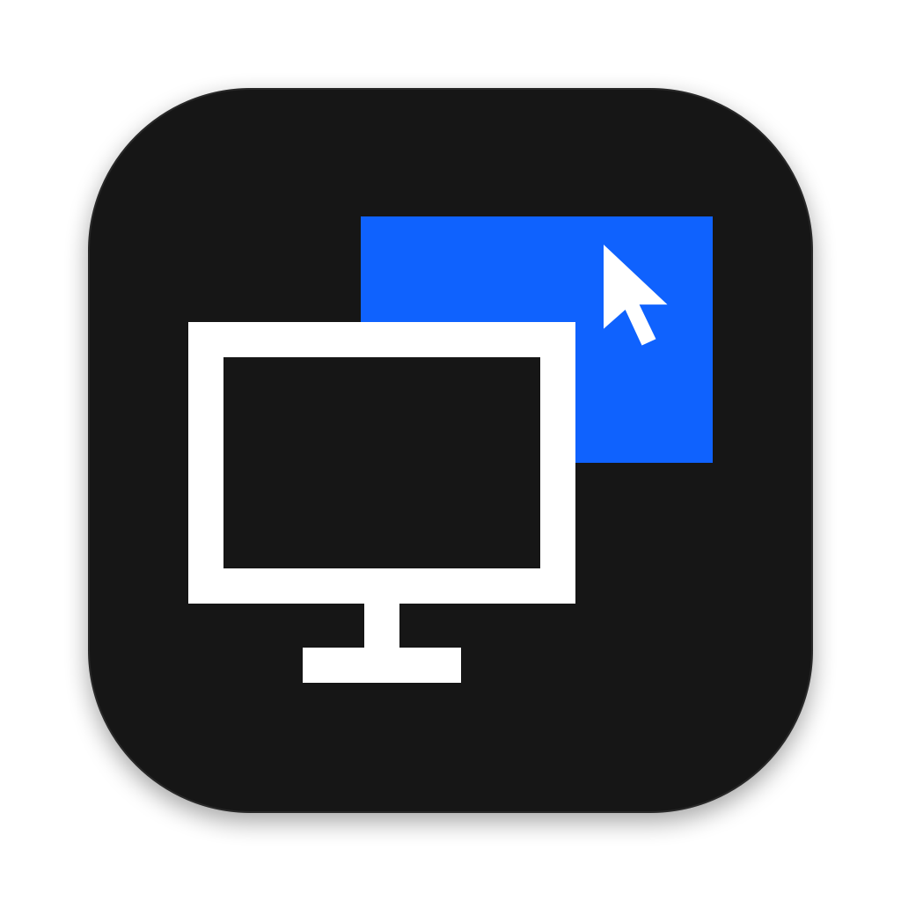
</p>

<p align="center">
  輕量、低延遲的遠端控制軟體：畫面清晰，鍵盤對 Mac 和 Windows 都友好，瀏覽器也能直接控制，還能讓 AI 操作你允許的電腦
</p>

<p align="center">
  <a href="https://nexadesk-bq9.pages.dev/zh-hant/">官網</a> · <a href="https://github.com/dollarkillerx/NexaDesk/releases/latest">下載</a>
</p>

<p align="center">
  <a href="./README.md">English</a> | <a href="./README.zh-CN.md">简体中文</a> | <strong>繁體中文</strong> | <a href="./README.ja-JP.md">日本語</a> | <a href="./README.ko-KR.md">한국어</a>
</p>

## 功能特性

- **低延遲畫面** - ScreenCaptureKit 擷取，VideoToolbox 硬體編碼 HEVC / H.264，用低延遲位元率控制和長期參考幀（LTR）：丟幀後只讓失效幀之後的畫面重新參考，不必等關鍵幀。能區分 Wi‑Fi 的短暫中斷和網路擁堵。有人連著時被控端的顯示器不會因空閒關閉；顯示器已睡著時會先喚醒，和 Apple 螢幕共享一樣。
- **傳輸** - 一個 UDP socket 上跑 QUIC：控制走可靠流，視訊走 DATAGRAM，每幀帶 Reed-Solomon 糾錯，丟一個包不會卡住後面的幀。
- **連線，預設不用伺服器**
  - 區域網路：mDNS 自動發現，直接連線。
  - 跨網路：**推薦 Tailscale**。兩邊登入同一個 Tailscale 帳號即可互連；NexaDesk 會列出 tailnet 裡的裝置，並標明是直連還是經 DERP 中轉。
  - 可選的自建伺服器：按 9 位裝置 ID 連線，先打洞和埠對映（PCP、NAT-PMP、UPnP），打不通走 UDP 中繼，UDP 被封鎖時走 WebSocket 中繼。
- **對 Mac 和 Windows 都友好的鍵盤** - 按物理鍵碼傳輸，按意圖改寫組合鍵：在 Mac 上按 ⌘C 控制 Windows 時發出 Ctrl+C，而不是全域對調 Ctrl 和 Cmd。對映表可以編輯和預覽。符號預設按控制端鍵盤上印的字輸入，兩邊佈局不同時（比如日文鍵盤控制英文配列的 Mac）也不會打錯。
- **貼上不會出錯** - 剪貼簿按代際同步；貼上會等新內容到達對端再放行，大圖還在下載時也一樣，不會貼出舊內容。文字和圖片都能同步。
- **瀏覽器控制** - 對方不用安裝任何軟體。
  - 區域網路和 Tailscale 裡，用瀏覽器開啟 `https://本機地址:47801`，頁面和 WebRTC 都由本機提供，不經過伺服器。
  - 有自建伺服器時，從任何網路開啟伺服器網址、輸入裝置 ID 連線。先經伺服器的 TURN 中轉；本機允許之後才把區域網路和 Tailscale 地址告訴瀏覽器，能直連時自動切換。
  - 指標在瀏覽器本地畫，移動沒有延遲。
  - 連過的裝置儲存在瀏覽器裡，點一下就能再連；密碼用頁面也導不出的金鑰加密儲存，一次性碼從不儲存。
  - 手機可用：觸控手勢、螢幕鍵盤、輸入法，以及一排 Esc、Tab、修飾鍵和方向鍵。
  - 預設關閉，在「設定」裡開啟"允許瀏覽器連線"。
- **命令列** - 只打開對方的 shell：應用裡用原生終端機控制元件（macOS 和 Windows 相同），瀏覽器裡用 xterm.js。這是單獨一項權限，預設不勾；工作階段結束時 shell 和它啟動的所有程序一起結束。沒有圖形介面的 Linux / Windows 機器用命令列被控端 `nexa-term-host`（bash / PowerShell），見 [docs/TERM_HOST.md](docs/TERM_HOST.md)。
- **AI 代理（MCP）** - NexaDesk 自帶 MCP 服務，Claude Code、Codex、Claude Desktop 等 AI 應用可以操作你允許的電腦：把螢幕讀成介面元素來操作，需要時截圖，也能在命令列裡執行命令、收發檔案。由 NexaDesk 用你儲存的密碼登入，AI 看不到任何密碼、一次性碼或金鑰；被操作的電腦每次都會詢問，並顯示是 AI。見下文 [AI 代理](#ai-代理mcp)。
- **多人同時連線** - 最多 4 人同時連線同一台 Mac（應用和瀏覽器合計），每人單獨確認，都能操作，互不頂替；誰離開就只結束誰的工作階段。
- **登入方式** - 一次性碼（對方點允許）；固定密碼（機主自己的入口，不彈確認）；經伺服器時也可以只填裝置 ID，對方會看到標明"無法核實身份"的請求。裝置 ID 可以隨時重置。
- **隨時能連上** - NexaDesk 啟動時（包括"重新啟動以更新"之後）自動開啟"允許別人控制本機"，遠端更新被控端不會把自己關在外面；自己點"停止"後保持關閉，直到再點"開始"。也可以設為登入時啟動。
- **其他** - 游標形狀、聲音（Opus）、檔案收發、多顯示器、遊戲模式（鎖定指標、更強糾錯）、斷線 30 秒內自動重連、HUD 與連線診斷。
- **多語言** - English、简体中文、繁體中文、日本語、한국어。預設跟隨系統語言，也可以在「設定」裡切換（重新啟動後生效）。
- **安全**
  - 雙向 TLS，身份就是裝置公鑰。
  - 首次連線用一次性碼或固定密碼做 SPAKE2 配對，並繫結到 TLS 工作階段；之後釘住對方公鑰。固定密碼只儲存 Argon2id 的結果。
  - 被控時本機要確認（可對已配對裝置設為無人值守；固定密碼直接進入），並一直顯示提示列。
  - 配對猜測按來源限制。

## 截圖

主視窗按要做的事分頁。「連線別人」自動列出區域網路和 Tailscale 裡的裝置，以及用過的裝置和它們的標籤（已配對、已儲存密碼、允許 AI）。「讓別人連我」放大顯示本機的裝置 ID 和一次性碼（點一下就複製）以及對方可輸入的地址。「已配對裝置」和「設定」放其餘內容。自動跟隨系統的淺色和深色。

<p>
  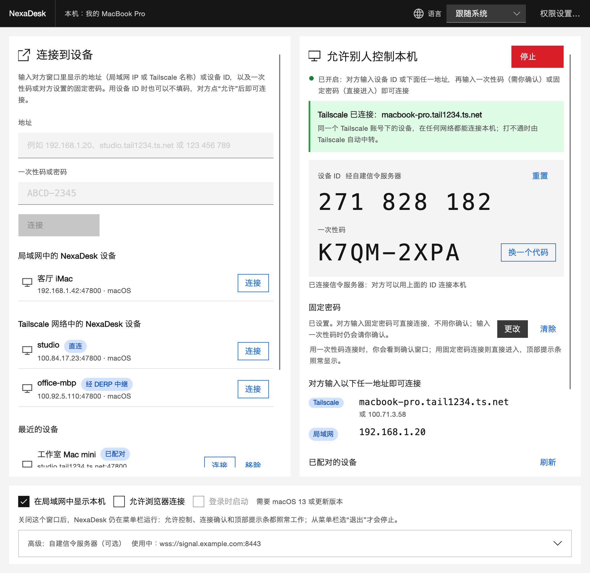
  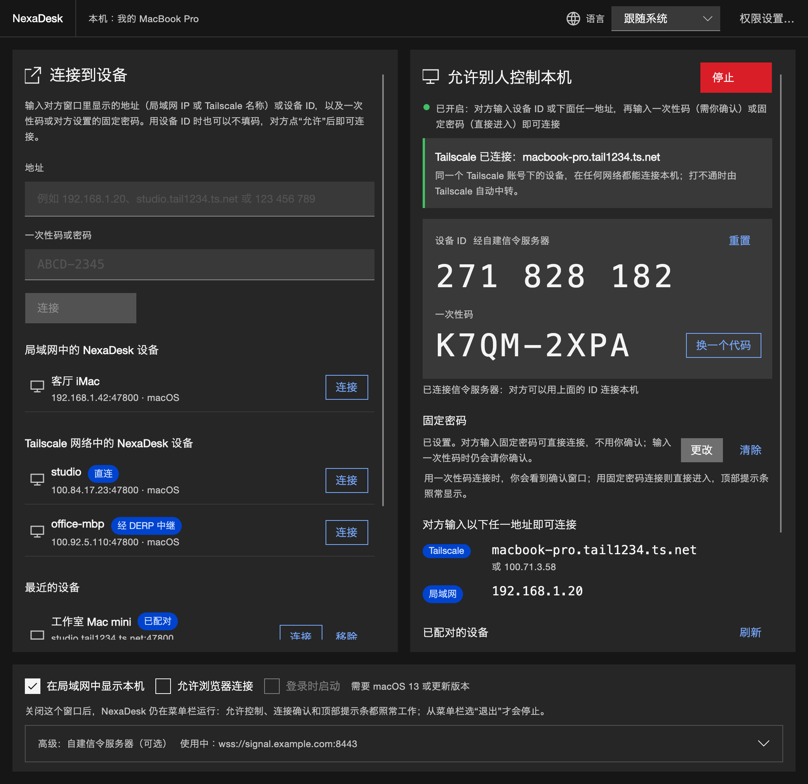
</p>
<p>
  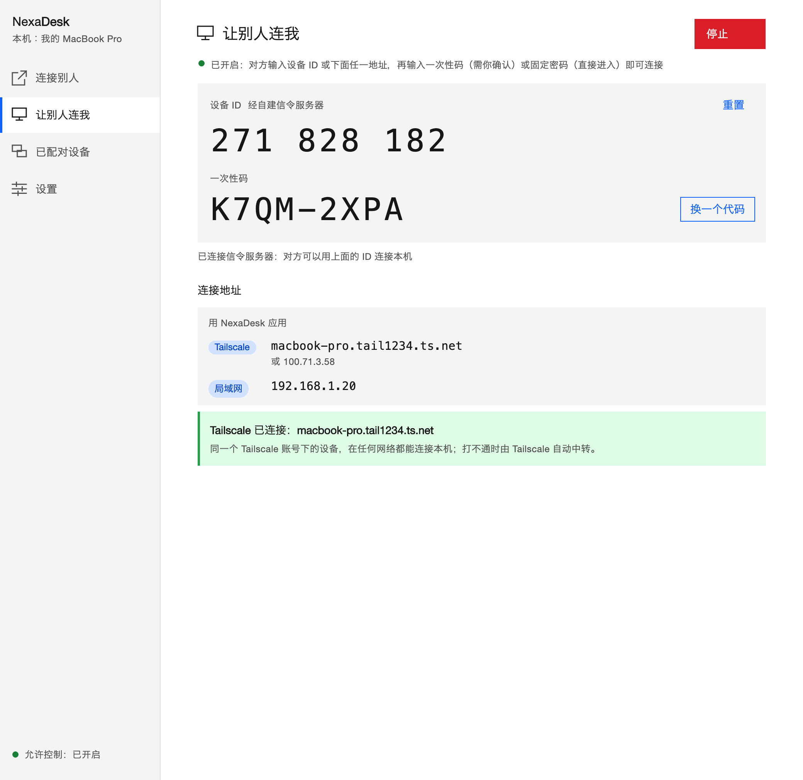
</p>

有人連線時，本機彈出確認視窗：顯示對方是誰、怎麼驗證的、金鑰指紋，由你勾選允許的權限。"拒絕"是預設按鈕，"允許"在窗口出現一秒後才能點。瀏覽器端不用安裝任何軟體，連線時可以選"螢幕"或"終端機"；連過的裝置可以儲存在瀏覽器裡，下次點一下就能連上。

<p>
  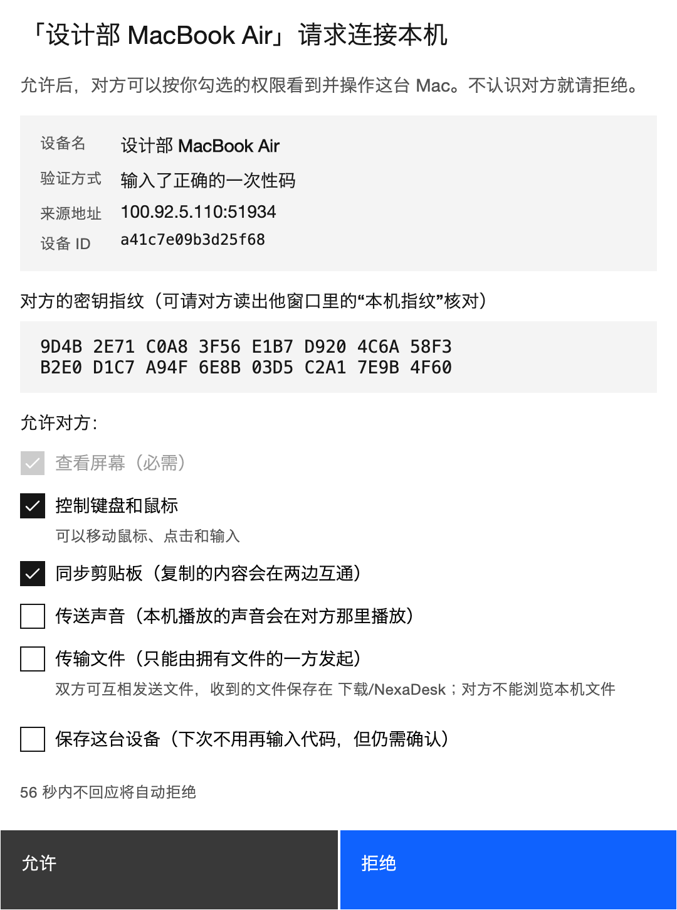
  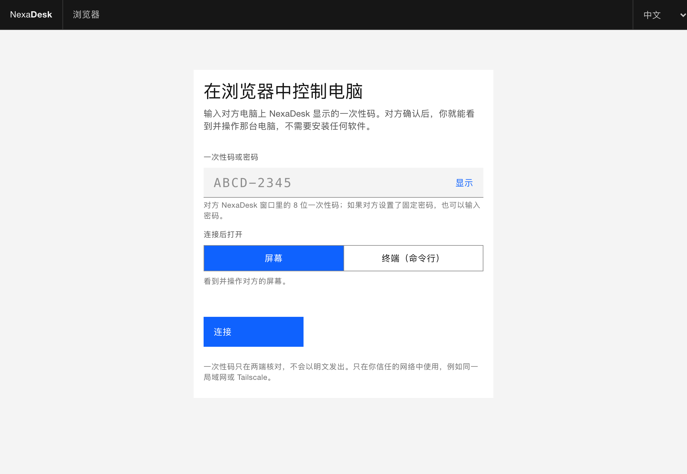
</p>

瀏覽器裡看到並操作對方的螢幕。頂欄顯示連線方式、延遲和幀率；展開後可以看丟包和位元率，切換畫質和解析度，以及符號鍵按鍵上的字還是按位置輸入。選"終端機"時只打開對方的命令列，不傳畫面。

<p>
  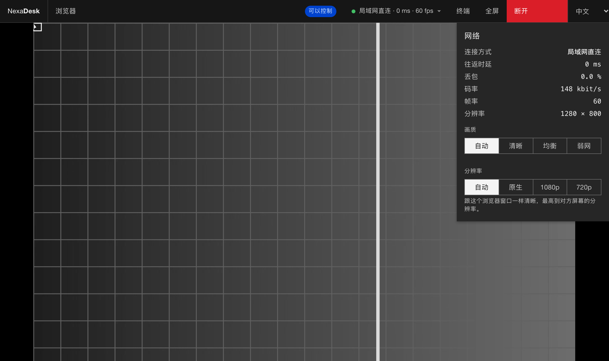
  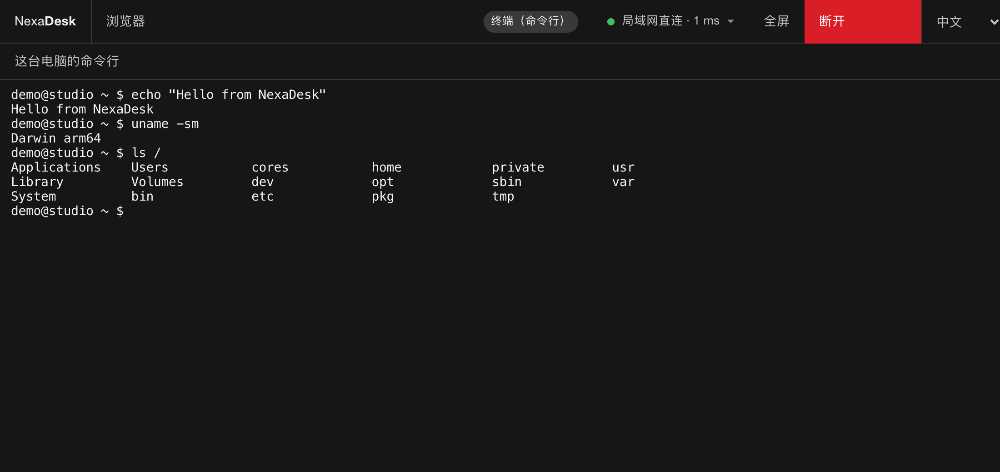
</p>

手機上頂欄換成圖示，橫屏時給畫面讓出更多空間，彈出鍵盤時多一排 Esc、Tab、修飾鍵和方向鍵。

<p>
  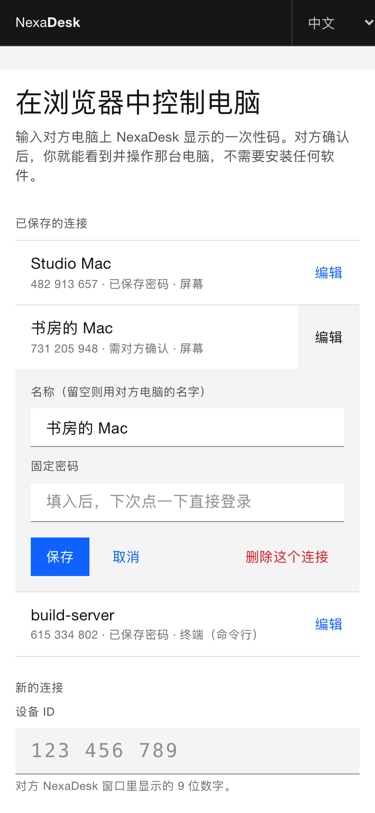
  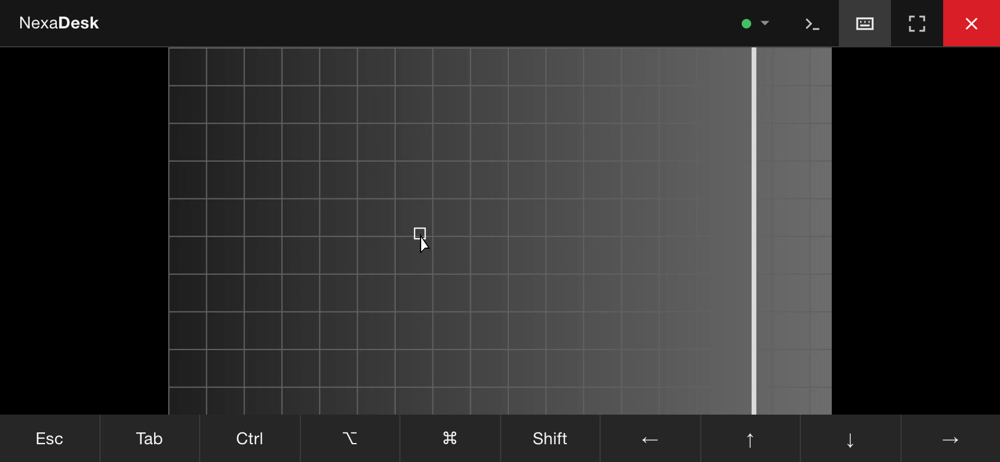
</p>

控制別人時，畫面上方是工具列（模式、聲音、檔案、HUD、診斷），可以收起成一個能拖到一邊的小標籤。被控制時，本機頂部一直顯示提示列，每個連線的人或 AI 代理一行，可以單獨中斷；可以收起成一個能移動的小標籤，但不會完全隱藏。

<p>
  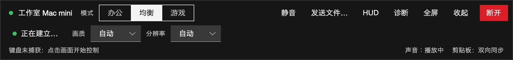<br>
  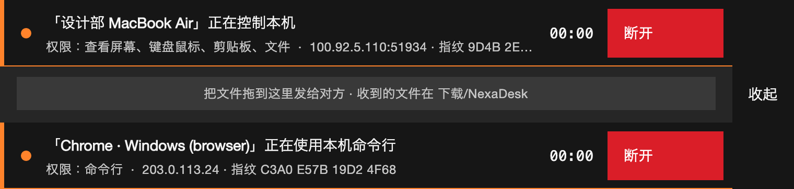
  
</p>

AI 代理：設定 →「AI 代理（MCP）」為本機的 AI 應用開啟 MCP 服務，給出加到 AI 應用裡的命令或 JSON，並顯示哪個 AI 應用在操作哪台裝置，可以「全部停止」。被操作的電腦會先詢問，並標明是 AI。

<p>
  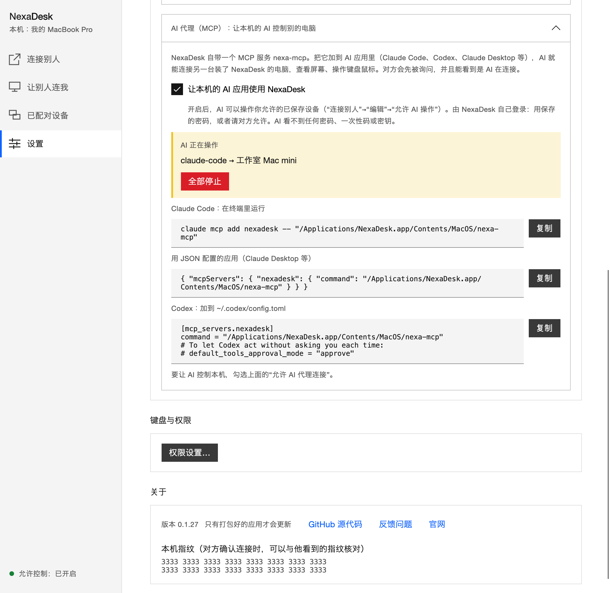
  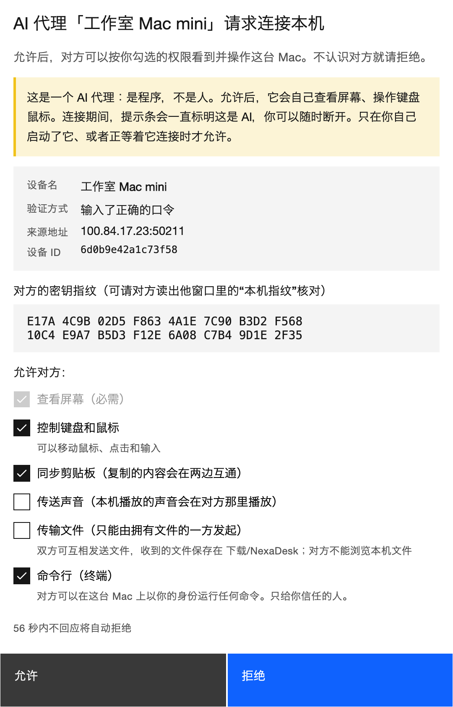
</p>

<sub>截圖裡的裝置、地址、程式碼和已儲存的連線都是虛構的。介面改動後執行 `scripts/screenshots.sh` 重新生成：應用介面由 `ui/NexaDesk.Screenshots` 用真實的介面程式碼離屏渲染；瀏覽器頁面由 `scripts/web-screenshots.mjs` 在無介面的 Google Chrome 裡對演示主機擷取（電腦和手機尺寸各一遍）。</sub>

## 下載

從 [GitHub Releases](https://github.com/dollarkillerx/NexaDesk/releases/latest) 或[官網](https://nexadesk-bq9.pages.dev/)下載：

- **macOS**（Apple 晶片，macOS 14+）：[NexaDesk-macOS.dmg](https://github.com/dollarkillerx/NexaDesk/releases/latest/download/NexaDesk-macOS.dmg)，Developer ID 簽名並經 Apple 公證。
- **Windows**（x64，Windows 10 / 11）：[NexaDesk-win-Setup.exe](https://github.com/dollarkillerx/NexaDesk/releases/latest/download/NexaDesk-win-Setup.exe)，按使用者安裝，不需要管理員權限；還沒有程式碼簽名，SmartScreen 提示時點**更多資訊 → 仍要執行**。

兩個版本都會自動更新（[Velopack](https://velopack.io)）：啟動後和之後每天檢查一次 GitHub Releases，有新版本就在後台下載，在「設定」裡顯示"重新啟動以更新"。不會自動重新啟動，因為重新啟動會中斷遠端連線。

## 使用

1. 兩台 Mac 都開啟 NexaDesk，按提示授予"螢幕錄製"和"輔助使用"權限，首次在區域網路使用時還要允許"區域網路"。
2. 不在同一個區域網路時，兩台都安裝 [Tailscale](https://tailscale.com/download) 並登入同一個帳號。
3. 被控的一台在「讓別人連我」頁點"開始"。預設監聽所有網路，窗口裡會列出對方可以輸入的地址（Tailscale 名稱、區域網路 IP）和一次性碼。
4. 控制的一台在「連線別人」頁選擇對方，然後輸入一次性碼：
   - 在"區域網路中的 NexaDesk 裝置"或"Tailscale 網路中的 NexaDesk 裝置"裡點"連線"；
   - 也可以手動輸入對方的地址，例如 `192.168.1.20` 或 `studio.tail1234.ts.net`（預設埠 47800）。
5. 被控端確認後開始控制。配對過的裝置下次可以直接連線。

不能用 Tailscale 時，可以自建信令伺服器，按 9 位裝置 ID 連線，做法見下面的[自建信令伺服器](#自建信令伺服器)。

被控端可以設一個**固定密碼**：用它連線時直接進入，不彈確認視窗，適合連自己的電腦。

沒有圖形介面的 Linux 或 Windows 機器，用命令列被控端：`scripts/build-term-host.sh` 建置，`nexa-term-host --signal wss://你的伺服器:8443` 執行，然後在瀏覽器裡開啟伺服器網址、選"終端機"、輸入它印出的裝置 ID。詳見 [docs/TERM_HOST.md](docs/TERM_HOST.md)。

被控端也可以從命令列執行，在終端機裡確認連線：

```bash
nexa-agent --listen '[::]:47800'
```

`nexa-agent --help` 列出全部選項，例如 `--paired-only`、`--relay-only`、`--no-lan-discovery`。

## AI 代理（MCP）

本機的 AI 應用通過 NexaDesk 操作別的電腦，和你自己操作一樣：由 NexaDesk 登入，被操作的電腦會詢問那邊的人，AI 看著螢幕操作。

1. 在 AI 所在的電腦上，開啟 設定 →「AI 代理（MCP）」，勾選「讓本機的 AI 應用使用 NexaDesk」。從這裡複製對應 AI 應用的配置，例如 Claude Code：
   ```bash
   claude mcp add nexadesk -- "/Applications/NexaDesk.app/Contents/MacOS/nexa-mcp"
   ```
   同一處還有 Claude Desktop 等應用用的 JSON，以及 Codex 的 `~/.codex/config.toml` 配置。
2. 在「連線別人」頁，點已儲存裝置的「編輯」，勾選「允許 AI 操作」並儲存。AI 只看得到、只連得上這些裝置，按名字連線。NexaDesk 用為該裝置儲存的密碼登入；用裝置 ID 連線時，請對方允許。AI 看不到任何密碼、一次性碼或金鑰。
3. 在要被操作的電腦上，在「設定」裡開啟「允許 AI 代理連線」。每次 AI 連線仍會詢問，確認視窗和提示列都標明是 AI；命令列是單獨一項權限。

然後對 AI 說，比如「連上我的 MacBook，開啟 Chrome 測一下網速」。它把螢幕讀成介面元素（按鈕、輸入框、列表行）來操作，需要看時才截圖，還可以在命令列裡執行命令，以及發檔案過去、按路徑取檔案回來（取檔案還需要允許命令列，命令列本來就能讀對方的任何檔案）。`nexa-mcp` 本身只在 AI 應用和 NexaDesk 之間轉發，不儲存任何東西。設計見 [docs/MCP.md](docs/MCP.md)。

## 排查問題

想知道連線為什麼中斷：NexaDesk.app 把被控端的日誌寫在 `~/Library/Logs/NexaDesk/agent.log`，裡面有每個工作階段的開始、結束和原因，以及每 5 秒一行的位元率統計（幀數、位元率、目標、Wi‑Fi 中斷）。超過 1 MB 時舊的移到 `agent.log.1`。

## 自建信令伺服器

`nexa-signal` 是一個程序：信令（裝置 ID）、STUN、不能直連時的 UDP/WebSocket 中繼，還可以提供瀏覽器網頁。畫面、輸入和剪貼簿始終是端到端加密的，伺服器看不到。你需要一台有公網 IPv4 的 Linux 伺服器（x86_64、systemd），以及 root 權限。

```bash
curl -fsSL https://raw.githubusercontent.com/dollarkillerx/NexaDesk/main/deploy/install.sh | sudo sh
```

指令碼會下載程式並校驗 SHA-256，隨機生成一個**信令口令**，做好憑證，裝好並啟動服務，給 ufw / firewalld 放行埠，最後印出伺服器地址、口令和憑證指紋。再執行一次就是升級，配置保持不變。常用選項（寫在 `sh -s --` 後面）：`--host <IP 或域名>`、`--port <埠>`、`--web [密碼]`（同時提供瀏覽器網頁，密碼可不寫）、`--key <口令>`。用 `sh install.sh --show` 可以重新檢視結果。

然後在每台要用這台伺服器的 Mac 或電腦上，開啟 設定 →「高階」，填伺服器地址和口令（信令伺服器一定要口令），點「儲存」；再在「讓別人連我」頁停止後重新開始一次，被控端才會註冊上去。第一次連線使用私有憑證的伺服器時，會讓你核對憑證指紋並信任。

別忘了在雲廠商的安全組裡放行 TCP 443（或你選的埠）和 UDP 3478、3480。想用自己的域名和正規憑證，用 `--host 你的域名`，並看 [docs/DEPLOY.md](docs/DEPLOY.md)，裡面還有手工安裝、Docker、換口令和運維。

**把伺服器分享給大家。**本儲存庫的 `servers.json` 列出了伺服器和口令。「高階」裡的開關「從公開的伺服器列表裡選」（預設關閉）會讀取它，選一項就填好地址和口令。列表裡的口令是公開的，只能擋住不知道這個列表的人。

## 從原始碼建置

需要：macOS 14+、Xcode 命令列工具、Rust stable（edition 2024）、[.NET 10 SDK](https://dotnet.microsoft.com/download/dotnet/10.0)。

```bash
git clone https://github.com/dollarkillerx/NexaDesk.git
cd NexaDesk

scripts/package-macos.sh                              # 打包應用：dist/NexaDesk.app
cargo build --release -p nexa-agent -p nexa-client    # 只編譯 Rust 部分
```

預設是 ad-hoc 簽名：每次重新打包，macOS 都會把它當成新應用，"螢幕錄製""輔助使用"權限和鑰匙串的"始終允許"都要重新給。先執行一次下面的指令碼，在登入鑰匙串裡建一個本機簽名憑證（"NexaDesk Local Signing"），之後每次打包都用它簽名，給過的權限不會再丟：

```bash
scripts/make-signing-identity.sh
```

這個憑證的私鑰只應留在本機：拿到它的人可以簽出被 macOS 當作 NexaDesk、帶著同樣權限的程式。鑰匙串裡有 Developer ID Application 憑證時，指令碼會優先用它，並開啟 hardened runtime（公證需要）。

應用圖示在 `assets/icon/`，由 `scripts/make-app-icon.swift` 用程式碼繪製；修改後執行 `scripts/make-app-icon.sh` 重新生成。

### 釋出

在 Mac 上打兩個平台的包，然後把 `dist/macos/` 和 `dist/windows/` 裡的檔案全部上傳到同一個 GitHub Release（更新程式從最新的 Release 讀 `releases.osx.json` / `releases.win.json`）：

```bash
NEXA_NOTARY_PROFILE=<notarytool 憑據名> scripts/package-macos.sh
scripts/package-windows.sh
```

版本號來自 `ui/NexaDesk.App/NexaDesk.App.csproj` 的 `<Version>`。Windows 包用 mingw 交叉編譯，見 [docs/WINDOWS.md](docs/WINDOWS.md)。

### 測試

```bash
cargo test --workspace
dotnet test ui/NexaDesk.Tests
```

需要真實硬體或網路的測試預設忽略，例如真實組播、螢幕擷取，以及會觸發系統權限提示的測試。

試用瀏覽器端，不需要螢幕錄製權限（合成畫面，經真實 H.264 編碼器；收到的滑鼠和按鍵會畫進畫面）：

```bash
cargo run -p nexa-web --example demo
```

然後在瀏覽器裡開啟 `https://本機區域網路地址:47801`（不要用 127.0.0.1），接受自簽憑證的提示，輸入終端機裡顯示的一次性碼。按 F9 會讓演示主機"複製"一行文字，可以用來試剪貼簿。改了 `crates/nexa-web-pake` 之後，執行 `scripts/build-web-pake.sh` 重新生成 `crates/nexa-web-page/web/pake.wasm`。

## 儲存庫結構

| 路徑 | 內容 |
|---|---|
| `crates/nexa-wire` | 線上格式：資料包、幀、控制訊息、信令訊息 |
| `crates/nexa-net` | 自定義 QUIC socket、擁塞與位元率控制、FEC、STUN、打洞、路徑管理、埠對映、Tailscale、mDNS |
| `crates/nexa-media` | 擷取、編解碼、呈現、游標、音訊（macOS 和 Windows） |
| `crates/nexa-input` | 組合鍵改寫、鍵位表、輸入擷取與注入 |
| `crates/nexa-clip` | 剪貼簿同步與貼上閘門 |
| `crates/nexa-auth` | 裝置身份、配對、釘住、存取決策 |
| `crates/nexa-session` | 工作階段握手、被控端與控制端的工作階段邏輯、檔案傳輸、重連、會合 |
| `crates/nexa-agent` | 被控端程序 `nexa-agent` |
| `crates/nexa-client` | 控制端動態庫 `libnexa_client`（C ABI，供 UI 呼叫），以及給 AI 代理的 MCP 服務 |
| `crates/nexa-mcp` | AI 應用執行的 `nexa-mcp`：把它們的 MCP 訊息轉給 NexaDesk 應用 |
| `crates/nexa-signal` | 信令 + STUN + 中繼伺服器 `nexa-signal` |
| `crates/nexa-web` | 瀏覽器存取：HTTPS、信令和 WebRTC（str0m），由被控端提供；經伺服器的工作階段走 TURN |
| `crates/nexa-web-page` | 瀏覽器端網頁，由被控端和信令伺服器共用 |
| `crates/nexa-turn` | TURN 伺服器與客戶端（純狀態機），只在同一伺服器的分配之間中轉 |
| `crates/nexa-web-pake` | 瀏覽器一側的配對（SPAKE2），編譯為 WebAssembly |
| `crates/nexa-term` | 偽終端機上的 shell（Linux / macOS 用 PTY，Windows 用 ConPTY），隨工作階段結束整個程序樹 |
| `crates/nexa-term-host` | 只有命令列的被控端 `nexa-term-host`，用於 Linux、Windows 伺服器 |
| `ui/` | Avalonia 桌面應用（.NET 10）、終端機控制元件（`NexaDesk.Terminal`）、測試和 README 截圖工具 |
| `deploy/` | 伺服器的 systemd 單元、Docker 映象與 Compose、配置模板、憑證續期鉤子 |
| `docs/` | 設計文件、部署說明、M0 驗證報告 |
| `spikes/` | M0 階段的驗證程式碼 |
| `third_party/` | 打了小補丁的第三方程式碼（dimpl，讓 Linux 版不依賴 aws-lc），說明見其中的 README |

## 文件

- [docs/DESIGN.md](docs/DESIGN.md)：總體設計與里程碑
- [docs/DETAILED_DESIGN.md](docs/DETAILED_DESIGN.md)：詳細設計，各章末尾的"實現修訂"記錄了實際實現與設計的差異
- [docs/DEPLOY.md](docs/DEPLOY.md)：部署信令、STUN 和中繼伺服器
- [docs/WEB_CLIENT.md](docs/WEB_CLIENT.md)：瀏覽器控制端
- [docs/MCP.md](docs/MCP.md)：AI 代理（MCP）
- [docs/TERM_HOST.md](docs/TERM_HOST.md)：Linux / Windows 命令列被控端
- [docs/WINDOWS.md](docs/WINDOWS.md)：Windows 版
- [docs/spikes/M0-report.md](docs/spikes/M0-report.md)：M0 驗證報告

## 尚未完成

- **驗證**：真實 NAT 環境下的打洞測試（經自建伺服器中繼已在公網實測，見 docs/DEPLOY.md §7）。
- **macOS**：登入介面和鎖屏前的遠端存取。
- **Windows**：實機測試中發現的不少問題（被控端和控制端都有）；控制端顯示對方的指標形狀、HEVC、聲音、作為服務執行（登入介面和 UAC），見 [docs/WINDOWS.md](docs/WINDOWS.md)。
- **瀏覽器端**：iPhone / Safari、Firefox 上的實測（Android 上的 Chrome 已在用）；TURN over TCP/TLS（UDP 被封的網路）；聲音和檔案傳輸。
- **命令列被控端**：Windows 版的實機執行；作為 Windows 服務執行。
- **產品決定**：無人值守機器的首次配對方式；知道 ID 的人預設能做什麼；檔案權限是否按方向拆開。

## 授權

NexaDesk 是自由軟體，採用 GNU Affero 通用公共許可證第 3 版或（由你選擇）任何更新的版本（`AGPL-3.0-or-later`），見 [LICENSE](LICENSE)。如果你修改了它並通過網路提供給別人使用，必須向這些使用者提供修改後的原始碼。[third_party/](third_party/) 下的程式碼保留各自的許可。
